# Vocably — Project State

> This file is a snapshot, not a source of truth. `CLAUDE.md`, `SPEC.md`,
> `DATA_MODEL.md`, and `DESIGN_REFERENCE.md` remain the authoritative
> project documents. If anything here conflicts with the live repository
> or with those four documents, the live repository / those documents win
> — update this file, don't trust it blindly.

## 1. Current Status

**Milestones 1–4 complete and pushed to `origin/main`** (`bab8170`),
including the post-Milestone-4 pagination-bar layout fix. **Milestone 5
(Cloudflare Worker + guru "Tambah Kosakata") is complete** —
implemented (§5g), a real CORS configuration bug found and fixed during
manual testing (§5h), and manually verified end-to-end by the project
owner against the real deployed Worker and live Firestore (§5h). A new
sibling repo, `vocably-ai-worker/` (TypeScript, separate git history,
not a subdirectory of this Flutter repo, now has its own first commit)
holds the Worker itself; this repo's changes are the Flutter-side
integration (new services/providers/screens, `firestore.rules` guru
write access — deployed and confirmed working by real writes during
E2E testing). **One thing explicitly remains unconfirmed, not just
undeployed:** whether Cloudflare's native Rate Limiting binding is
available on the project owner's Workers plan — the Worker still runs
on the in-memory fallback (§5g/§7).

**Milestone 6 (Student Dashboard + Riwayat + Placement/Pre-Post-Test
scaffolds) is now implemented** (§5i) — real "Belajar"/"Riwayat"
screens replacing their Milestone 3 placeholders, read-only
`targetWordSets`/`learningProgress`/`learningSessions` access, the
one-time placement-test auto-offer, and placeholder screens for the
placement test and the research assessment (Pre-Test/Post-Test), per
the scope explicitly approved by the project owner. **Not yet
deployed or manually verified end-to-end** — `firestore.rules`/
`firestore.indexes.json` changes are written but undeployed, and
nothing in this milestone has been clicked through in a real browser
yet (§7/§5i). **A real, pre-existing environment defect was found
during this milestone's own verification, unrelated to any Milestone 6
code change:** `flutter test` at its default concurrency silently
drops a large, non-deterministic subset of test files (both new and
several pre-existing ones) while still reporting "All tests passed!"
with a clean exit code — `--concurrency=1` reliably runs the complete
suite instead. See §5i and §9 for the full finding and its evidence.

**Milestone 7 (Storyfier core — 3-phase learning flow) is complete,
deployed, and manually verified end-to-end** — implemented (§5j), then
hardened through a second pass of live-E2E-driven fixes referred to in
code comments as **"Milestone 7 Phase 2, Stages 1–8"** (§5k): story
target-word integrity, Cowrite bare-word/AI-fallback/completion-timing
fixes. `firestore.rules`'s Milestone 7 write rules **are deployed**
(reported by the project owner; corroborated by a real manual E2E pass
succeeding under them — see §5k). Both repos are **committed and pushed
to `origin/main`** (§10): `vocably` at `8f313f2`, `vocably-ai-worker` at
`cbb066a`. **Confirmed fresh (2026-08-31):** `flutter analyze` clean,
`flutter test --concurrency=1` 320/320 passing; `vocably-ai-worker`'s
`npm test` 89/89 passing, `npm run typecheck` clean. **One manual E2E
pass is recorded** (a "brown"/"building" two-word session reaching
`mastered` status) — this is a **project-owner-reported observation**,
not independently reproduced by an AI session (no browser access); see
§5k for exactly what is and isn't independently verifiable from the
repository alone.

**Milestone 8 (Guru: Set Target Kata + Edit Kata) is complete, committed,
and automated-test-verified** (§5l) — real "Target Kata" destination
(`TargetWordsScreen`), full-screen `SetTargetWordScreen` flow (CEFR level choice
chips, bundle word selector with search filter, date range picker with
"Tanpa batas akhir" sentinel `kNoEndDate`, writes to `targetWordSets`),
`VocabManagementScreen` shell with segmented control ("Tambah Kosakata"
$\leftrightarrow$ "Edit Kata"), `EditKataScreen` (level filter, search filter,
word list), and `_EditWordSheet` (read-only word info + editable `topics`
FilterChips and "+ Tambah topik baru" creator, saving only `topics` and
`updatedAt`). Restored role-agnostic logout in `AppNavShell`. Committed in
`1f2b606` (2026-09-05).

**Post-Milestone 8 Bugfixes and Polish are committed:**
- `56ded8b` (2026-09-09): "fix: remove duplicate student dashboard logout" —
  removed redundant local logout button on Student Dashboard now that
  `AppNavShell` hosts the global logout action.
- `34a9c4b` (2026-09-09): "fix: prevent translation marker leakage" — sanitized
  Co-Write AI feedback to prevent translation/morphological markers from leaking
  into the student feedback stream.
- **Pedagogical Bugfix (2026-10-12): Positional Leakage Elimination in Storyfier → Cloze Test (`fa4d52c` / `6239f7e`):**
  - Resolved systematic pattern where story sentence order matched target-word input order.
  - Worker (`generateStory.ts`): Removed the `"in the same order the target words were given"` prompt constraint; instructed model to sequence words by narrative flow without following list order. Validated via `validateMarkers()` set-based invariant checks. Added 3 new tests in `generateStory.test.ts`.
  - Flutter (`cloze_test_screen.dart`, `cloze_blanks.dart`): Replaced predictable dropdown order with session-stable randomized permutation (`shuffleClozeOptions`), preserving canonical `state.wordIds` and key-based grading (`gradeClozeAnswers`). Added 9 new tests across `cloze_blanks_test.dart` and `cloze_test_screen_test.dart`.
- **Co-Write Reliability Remediation — Phase 1 (2026-10-13) and Phase 2 (2026-10-15), committed in `2e175f1` (`vocably`) and `5bcb5e4` (`vocably-ai-worker`); Worker side deployed as Worker version `0bec79ee` (deployed 2026-10-15T17:08Z UTC, §5t); Flutter side not hosted** (§5o, §5p):
  - Deterministic student target-word validation and local rejection of target-word bare words/fragments/lists, with composer focus and keyboard retention (`cowrite_screen.dart`).
  - Phase 2: application-owned 3-consecutive-miss counter and one-word random fallback (bot usage validated from generated text, counted at session level only, never as student mastery); validator fixes (`Birds fly.`, `This works.`, `Okay.`, `said`/`bit`, comparatives, `lay`≠`lie`); feedback tied to the current student turn; Indonesian "Coba tulis" suggestions; anti-echo continuation with bounded retries.
  - CW-05 (§5q): credit for meaningful target-word use despite grammar or tense errors; model-reported surface forms mapped to base targets; spelling-rule inflections (no `attackked`); a retry never erases the first student assessment.
  - Indonesian/mixed-language input (§5r): deterministic app-side detection; a short "write in English" reminder; session coverage only, never independent mastery; the bot always writes in English and stays in the story.
  - CW-02 feedback (§5s): feedback prioritises current-turn target-word use; praise for rejected claims is replaced; a display-only ✓/💡/💬 indicator from validated results; a 502 instead of an unacceptable bot sentence.

- **Difficult Words selection (§5u, 2026-10-16, committed in `6423dd2`, Flutter only):** students choose which difficult words to relearn (none selected initially, Pilih Semua / Batalkan Pilihan, "Pelajari Kembali (N kata)", no size cap); Riwayat re-fetches its data after the flow returns. Supersedes Milestone 7 Decision 2.

- **Research pretest/posttest — Milestone 1 (§5v, 2026-10-24, committed):** the app-safe instrument bank `assets/research/instrument_v1.json` (80 items, no answer key) is built and validated from the researcher's PDF by `tools/research/`. The private key is written only to an explicit path outside the repo and OneDrive; it was generated on 2026-10-24 and verified against a fresh build from the PDF. The assessment UI, Firestore, rules and export are **not** implemented. Placement test deferred.

- **Research pretest/posttest — Milestone 2a (§5w, 2026-10-24, committed, NOT deployed):** Firebase Emulator configuration plus Firestore security rules for `researchParticipants`, `researchAssessmentResults` and `researchInstrument`, with 70/70 rules tests passing against the local emulator (demo project), including the post-implementation security-audit regressions. No Flutter code changed; researcher tooling, the assessment UI, export and scoring are still not implemented.

**Confirmed fresh (2026-10-25 verification of the final research M1/M2a tree, immediately before it was committed):**
- `flutter analyze`: clean (**0 issues**).
- `flutter test --concurrency=1`: **486/486 passing** (100% of test suite).
- `tools/research`: `npm test` **46 passing, 2 skipped** (PDF/key checks need env vars); `npm run test:rules` **70/70 passing** on the local Firestore Emulator.
- `flutter build web --release --dart-define=WORKER_BASE_URL=...`: **succeeds (re-run 2026-10-24 after §5v; the bank is bundled at build/web/assets/assets/research/instrument_v1.json and contains no key-like strings)**.
  (Note: `--wasm` is blocked by legacy JS interop in `flutter_tts: ^4.2.2`).
- `vocably-ai-worker`: `npx vitest run --fileParallelism=false` **148/148 passing**, `npx tsc --noEmit` clean. The default parallel run can hit a Node out-of-memory error on this low-RAM machine.
- `tools/vocab_import`: `npm test` **43/43 passing**.
- `firebase.json`: **Hosting is NOT configured** (no `"hosting"` block).
- `firestore.rules`: Milestone 8 `targetWordSets` create rule is committed
  locally, pending deployment via `firebase deploy --only firestore:rules`.

## 2. Milestone History

| # | Milestone | Status |
|---|---|---|
| 1 | Skeleton project + Firebase connection | **Complete, pushed** |
| 2 | Auth: sign up, login, role-based routing | **Complete, pushed** |
| 3 | Design system / theme layer + responsive nav shell | **Complete, pushed** |
| 4 | Vocab module: `vocabWords`, CSV import, CEFR bundles, browse, DictionaryAPI, TTS | **Complete, pushed** (real data seeded, a post-seed Firestore-index bug found and fixed — see §5b; pagination-bar overflow fix — see §5f) |
| 5 | Cloudflare Worker + guru "Tambah Kosakata" | **Complete — implemented, deployed, and manually verified end-to-end (§5g/§5h). Committed (`25b4de0`) — see §10.** |
| 6 | Student dashboard + Riwayat + Placement/Pre-Post-Test scaffolds | **Implemented (§5i) — automated tests passing, `flutter analyze` clean. Committed (`c5c6c66`) — see §10. Deploying `firestore.rules`/`firestore.indexes.json` and a real browser click-through are still outstanding (§7).** |
| 7 | Storyfier core (3-phase learning flow) | **Complete — implemented (§5j), hardened via Stages 1–8 (§5k), deployed, and manually E2E-verified (project-owner-reported). Committed (`a7e4d01`, `8f313f2`) — see §10.** |
| 8 | Guru: Set Target Kata + Edit Kata | **Complete — implemented, automated test verified (348/348 passing across full suite, `flutter analyze` clean), committed (`1f2b606`). Follow-up bugfixes committed (`56ded8b`, `34a9c4b`). Firestore rules updated locally (pending deployment). Manual browser E2E verification pending.** |

### Milestone 4 stage detail

| Stage | What | Status |
|---|---|---|
| 1 | `VocabWord`/`VocabMeaning` models, `normalizeWord()` | Complete |
| 2 | Firestore rules: `vocabWords`/`topics` read-only for authenticated users | Complete, deployed by the project owner |
| 3 | `VocabBundleEntry` model + pure parser | Complete |
| 4 | `VocabBundleService` (asset load + Firestore delta merge) + providers | Complete |
| 5 | Vocabulary browse screen (abjad/tema/POS, 6 CEFR levels) | Complete |
| 6 | Learning cart (`LearningCart` Riverpod notifier, session-local) | Complete |
| 7 | Dev-side CSV import pipeline (`tools/vocab_import/`) — parse, validate, merge Oxford 3000+5000 | **Complete — run for real against the actual CSVs (§5)** |
| 8 | One-off Indonesian translation generation (OpenAI-compatible API) | **Complete — all 5,936 meanings translated and cached (§5)** |
| 9 | Firestore seed/import (Admin SDK) | **Complete — run for real by the project owner, 4,952 documents confirmed live (§5)** |
| 10 | Bundle generation (`assets/vocab/vocab_*.json`) | **Complete — real bundle files generated and verified against the actual `VocabBundleEntry` parser (§5)** |
| 11 | DictionaryAPI integration (word-detail screen, Layer 1 fallback) | Complete |
| 12 | TTS integration (`flutter_tts`, Layer 2 audio fallback) | Complete |
| 13 | Temporary dashboard entry point to browse | Still temporary and intentionally left in place — Milestone 6 replaces it |

## 3. Current Architecture

- **Framework:** Flutter (web-only), Dart, Riverpod with code generation exclusively.
- **Firebase:** `firebase_core`, `firebase_auth`, `cloud_firestore`, project `vocably-idn-en`, Spark plan, no Cloud Functions.
- **Design system:** `lib/theme/theme.dart` (`AppColors`/`AppSpacing`/`AppRadius`/`AppTextStyles`/`AppTheme`).
- **Navigation:** `AppNavShell` (`lib/widgets/app_nav_shell.dart`) — `NavigationRail` on wide screens, top tabs on narrow/mobile, one reusable widget for both siswa and guru.
- **Vocabulary data flow:** `assets/vocab/vocab_{level}.json` bundles (generated by `tools/vocab_import/`, loaded via `VocabBundleService`) + a live Firestore delta query for anything newer than the bundle's generation timestamp (`kBundleGeneratedAt`, `lib/utils/vocab_bundle_constants.dart`).
- **`meanings[].translation`** (renamed from `translationId` during this Milestone 4 run — see §8) holds the Indonesian translation text **directly**, inline — there is no separate `translations` collection.
- **DictionaryAPI + TTS:** `DictionaryApiService` (English definitions/phonetics, direct client call, no proxy) + `TtsService` (`flutter_tts`, always used for the speaker button — see §7's disclosed limitation on real recorded-audio playback).
- **Dev-side data pipeline:** `tools/vocab_import/` (Node.js, separate from the Flutter app) — see §5.
- **Backend/API beyond Firebase:** `vocably-ai-worker/` (Cloudflare Worker, TypeScript, separate sibling git repo — see §5g), accessed from Flutter via `AiWorkerService`.

### Directory structure (current)

```
lib/
  app.dart, main.dart, firebase_options.dart
  models/
    app_user.dart, vocab_word.dart, vocab_bundle_entry.dart, dictionary_entry.dart,
    topic.dart,                                           # Milestone 5
    target_word_set.dart, learning_progress.dart, learning_session.dart  # Milestone 6; gained
                                                            # write-side helpers in Milestone 7
  services/
    firebase_service.dart, auth_service.dart, user_service.dart,
    vocab_bundle_service.dart, dictionary_api_service.dart, tts_service.dart,
    ai_worker_service.dart, vocab_word_service.dart, topics_service.dart,  # Milestone 5;
                                                            # ai_worker_service.dart gained
                                                            # generateStory()/cowriteTurn() in
                                                            # Milestone 7
    target_word_set_service.dart, learning_progress_service.dart,
    learning_session_service.dart                          # Milestone 6, read-only; the latter
                                                            # two gained write methods in Milestone 7
  providers/
    auth_providers(+.g), sign_up_controller(+.g), login_controller(+.g),
    complete_registration_controller(+.g), vocab_bundle_providers(+.g),
    vocab_browser_providers(+.g), learning_cart_providers(+.g),
    dictionary_providers(+.g),
    ai_worker_providers(+.g), vocab_management_providers(+.g),
    lazy_translation_providers(+.g),                       # Milestone 5
    dashboard_providers(+.g), history_providers(+.g),
    placement_test_providers(+.g),                         # Milestone 6
    learning_session_controller(+.g), word_lookup_providers(+.g)  # Milestone 7
  screens/
    auth/login_screen.dart, sign_up_screen.dart, complete_registration_screen.dart
    student/
      dashboard/dashboard_screen.dart, target_word_list_screen.dart   # Milestone 6; CTA wired
                                                            # up in Milestone 7
      history/history_screen.dart, session_detail_screen.dart          # Milestone 6; "Pelajari
                                                            # Kembali" wired up in Milestone 7
      placement_test/placement_test_offer_screen.dart,
        placement_test_placeholder_screen.dart              # Milestone 6, scaffold only
      research_assessment/research_assessment_placeholder_screen.dart  # Milestone 6, scaffold only
      learning_flow/story_reading_screen.dart, cloze_test_screen.dart,
        cowrite_screen.dart                                 # Milestone 7 — Fase 1/2/3
      vocab_browser/vocab_browser_screen.dart, learning_cart_screen.dart, word_detail_screen.dart
                                                            # learning_cart_screen.dart's CTA
                                                            # wired up in Milestone 7
    teacher/
      target_words/target_words_placeholder.dart
      vocab_management/tambah_kosakata_screen.dart   # Milestone 5 — replaces the old placeholder
  theme/theme.dart
  utils/role.dart, normalize_word.dart, vocab_browse_filter.dart, vocab_bundle_constants.dart,
    cefr_levels.dart, topic_slug.dart, worker_config.dart,  # Milestone 5
    target_word_constants.dart, story_markers.dart, session_date_format.dart,  # Milestone 6
    mastery_rules.dart, cloze_blanks.dart                   # Milestone 7
  widgets/app_nav_shell.dart, mastery_badge.dart,             # mastery_badge.dart: Milestone 6
    stepper_header.dart                                     # Milestone 7

tools/vocab_import/            # separate Node.js tool, not part of the Flutter app — see §5
  bin/merge.js, translate.js, seed_firestore.js, generate_bundles.js
  lib/csvParser.js, normalize.js, merge.js, translateClient.js,
      translationCache.js, seedDecision.js, bundleGen.js, dotenv.js
  test/*.test.js
  input/ (git-ignored), output/ (git-ignored)

assets/vocab/                  # real per-level bundle files, generated by
                                # tools/vocab_import/ (§5, Stage 4/10)
```

```
# SEPARATE REPO (sibling directory, own git history) — see §5g:
vocably-ai-worker/
  src/index.ts, auth.ts, cors.ts, rateLimit.ts, openai.ts, env.ts
  src/handlers/translate.ts, generateStory.ts, cowriteTurn.ts
  test/*.test.ts, test/handlers/*.test.ts
  wrangler.jsonc, vitest.config.ts, README.md
```

`lib/screens/placeholders/` (Milestone 2's temporary routing-proof screens) has been deleted, as planned, once Milestone 3's real nav shell landed. `lib/screens/teacher/vocab_management/vocab_management_placeholder.dart` was deleted the same way in Milestone 5, once `tambah_kosakata_screen.dart` replaced it. `lib/screens/student/dashboard/dashboard_placeholder.dart` and `lib/screens/student/history/history_placeholder.dart` were deleted the same way in Milestone 6, once `dashboard_screen.dart`/`history_screen.dart` replaced them.

## 4. Authentication and Authorization

Unchanged since Milestone 2 — see `DATA_MODEL.md` §1 for the full schema/rules. No auth-related work happened in Milestone 3 or 4.

## 5. Data Population Pipeline (`tools/vocab_import/`) — detail

This is new in this Milestone 4 session. Full rationale/usage in
`tools/vocab_import/README.md`; summary here for the progress ledger.

**Why Claude built this (context for future sessions):** `CLAUDE.md`/
`DATA_MODEL.md` originally reserved CSV import, translation generation,
and bundle generation as "not Claude's job" (dev-only, own laptop, own
keys). The project owner explicitly authorized Claude to build this
pipeline mid-Milestone-4, on the condition that secrets and the first
real run of any costly/production-writing stage stay developer-gated.
`CLAUDE.md`/`DATA_MODEL.md` were updated to reflect this (§8 below).

**Stage 1 (merge) — run for real, against the actual Oxford CSVs:**
- Oxford 3000: 3,308 data rows. Oxford 5000: 2,015 data rows. 0 malformed rows in either file.
- **4,952 unique canonical `vocabWords` documents** after merging duplicates and the 21 Oxford 3000/5000 overlap words.
- 353 duplicate-word groups merged (multiple CSV rows → one document).
- CEFR distribution of the merged documents: A1 898, A2 792, B1 690, B2 1295, C1 1277 (no C2, as expected — Oxford source data doesn't reach C2).
- 10 "same-POS collision" cases flagged for manual review (same word + same POS contributed by two different rows — see `tools/vocab_import/README.md`'s "Known limitation" section and `DATA_MODEL.md` §2's translation note). Full list in `output/import_report.json`.
- Output: `tools/vocab_import/output/canonical_vocab.json` (git-ignored, regenerate anytime via `node bin/merge.js`).

**Stage 2 (translate) — complete, real run against the configured API:**
- Configuration (`.env` at repo root, not committed): `OPENAI_BASE_URL=https://ai.dinoiki.com/v1`, `OPENAI_API_PATH=/chat/completions`, `OPENAI_MODEL=gpt-4o-mini` — a pre-existing developer-configured OpenAI-compatible endpoint, not something Claude set up.
- A 5-item smoke test ran first and was manually spot-checked for quality (e.g. "abandon"→"meninggalkan", "ability"→"kemampuan" — correct, natural Indonesian) before scaling up.
- Full run: 5,936 total meanings across all 4,952 documents, batches of 25. One batch (of 238) reliably failed with a JSON-parsing error on the model's response for that specific 25-item grouping (not a transient network issue — retried identically and failed the same way); re-running with a smaller batch size isolated and resolved it — all 25 items translated fine individually. **Final state: all 5,936 meanings have a non-null translation, 0 remaining.**
- Spot-checked quality on several words post-completion — all correct and properly disambiguated by POS (e.g. "run" verb→"berlari"/noun→"lari", "light" noun/adjective/verb → "cahaya"/"ringan"/"menyalakan"). One minor known imperfection: "equal" as a noun (a rarer sense, "no equal") translated to "sama" (matches the adjective sense) rather than something like "tandingan" — not corrupted, just an imperfect rare-sense translation, worth a teacher's eventual review alongside the same-POS collision list.
- Output: `tools/vocab_import/output/translations_cache.json` (resumable cache, 5,936 entries) + `output/canonical_vocab_translated.json` (canonical data with translations applied, 0 nulls).

**Stage 3 (seed to Firestore) — complete, run for real by the project owner:**
- The project owner generated a service-account key (kept outside the repo), set `GOOGLE_APPLICATION_CREDENTIALS`, ran `node bin/seed_firestore.js --dry-run` then `--yes`, and confirmed in the Firebase Console that all 4,952 `vocabWords` documents (+ the `topics` master list) are now really present in the `vocably-idn-en` project.
- The decision logic (create vs. update vs. skip-unchanged vs. skip-foreign, idempotent reruns, never touching `source: "guru"` documents) was already fully unit-tested (`test/seedDecision.test.js`) before this run; it now also has a real production run behind it.
- A minor gap was found and fixed *after* this run (§5b): the seed pipeline never wrote the documented `posList` field. Not re-seeded now (harmless — nothing reads it from Firestore today); the fix makes a future rerun self-heal it (see §5b).

**Stage 4 (bundle generation) — complete, run for real:**
- `assets/vocab/vocab_a1.json` (898 words), `vocab_a2.json` (792), `vocab_b1.json` (690), `vocab_b2.json` (1295), `vocab_c1.json` (1277) — all generated from the real translated canonical data. No `vocab_c2.json` (no C2 data, as expected). `.gitkeep` removed since real files now exist.
- `lib/utils/vocab_bundle_constants.dart`'s `kBundleGeneratedAt` updated to the real generation timestamp.
- **Verified against the actual Flutter model**, not just assumed correct: a temporary test loaded all 5 files through the real `VocabBundleEntry.listFromJson` parser — **0 of 4,952 entries failed to parse**, every entry has a non-empty `word`/`meanings` and the expected `cefrLevel`.
- **A real regression was caught and fixed by this verification**: `test/screens/vocab_browser_screen_test.dart` started hanging (`pumpAndSettle` timeout) once real, sizeable bundle files existed, because it had been implicitly relying on `rootBundle.loadString` failing fast (asset didn't exist yet) — a genuine multi-hundred-KB disk read doesn't resolve within `flutter test`'s fake-async pump loop without `tester.runAsync()`. This is a test-harness artifact, not a production bug (a real running app resolves this normally) — fixed by injecting a fake `AssetBundle` in that test, the same pattern `vocab_bundle_service_test.dart` already used, so the test no longer depends on real disk I/O timing.

## 5b. Bug Fix — Vocabulary Browse Failed to Load Real Data

**Symptom:** after the real Firestore seed (§5) completed and was verified in the console, `Jelajahi Kosakata` → any CEFR level × any browse mode (A1/A2/B1 × Abjad/Tema all tried) hung loading, then showed "Gagal memuat kosakata" / "Coba lagi" — which just repeated the same failure.

**Root cause (confirmed, not guessed):** `VocabBundleService.fetchDelta()` runs
```dart
firestore.collection('vocabWords')
  .where('cefrLevel', isEqualTo: cefrLevel)
  .where('updatedAt', isGreaterThan: Timestamp.fromDate(bundleGeneratedAt))
```
— an equality filter on one field plus a range filter on a *different* field, which Firestore requires a composite index for. `DATA_MODEL.md` §11.5 already documented that this index was needed ("index baru `cefrLevel + updatedAt` ditambahkan untuk query delta") — but `firestore.indexes.json` still had `"indexes": []`, and running `firebase firestore:indexes` against the live project confirmed **zero composite indexes actually existed there either.** The index was described in the docs but never actually created. With an empty `vocabWords` collection (before the real seed) this never mattered; once ~5,000 real documents existed and the query actually ran, Firestore rejected it with `FAILED_PRECONDITION` ("query requires an index"). `loadLevelWithDelta()` didn't catch this, so the exception propagated all the way to the `vocabLevel` provider as an `AsyncError` — for every level and every browse mode, since the failure happens before any level/mode-specific logic runs at all. This matches the reported symptom exactly.

**Files changed:**
- `firestore.indexes.json` — added the `vocabWords` composite index (`cefrLevel` ASC, `updatedAt` ASC) that should have been there since Milestone 4 Stage 2.
- `lib/services/vocab_bundle_service.dart` — `loadLevelWithDelta()` now catches a `fetchDelta()` failure and falls back to bundle-only data (logged via `debugPrint`) instead of letting the whole level fail. This means: (a) the browse screen now works immediately even before the index finishes deploying/building, and (b) any *future* transient delta failure (index rebuild, brief network issue) degrades to "no freshness top-up this load" instead of an outright failure — matching the graceful-degradation pattern `SPEC.md` §3.5 already uses for DictionaryAPI.
- `test/services/vocab_bundle_service_test.dart` — two new tests: `fetchDelta` throwing still returns bundle data (this is the regression test; confirmed it fails against the pre-fix code via a manual revert-and-rerun), and `fetchDelta` succeeding still merges normally.
- `tools/vocab_import/lib/seedDecision.js` (+ `test/seedDecision.test.js`) — secondary finding from the same investigation, not the crash's cause: the seed pipeline never wrote the documented `posList` field (`DATA_MODEL.md` §2 says Firestore must persist it since there are no computed fields; `VocabWord.toMap()` on the Dart side already does). Fixed so future creates/updates include it, and so an existing document missing it is now detected as needing an update (self-healing backfill on the next rerun) rather than wrongly treated as already up to date. **Not a cause of the reported bug** — `VocabWord.fromFirestore` never reads `posList` back — and the already-seeded 4,952 documents were deliberately **not** re-seeded for this alone.
- `DATA_MODEL.md` §11.3/§11.5 — recorded this bug and its fix inline.

**Verification:**
- `flutter analyze`: no issues.
- `flutter test`: **116/116 passing** (full suite).
- `tools/vocab_import` (`node --test`): **43/43 passing**.
- The new regression test was confirmed to actually fail against the pre-fix code (temporarily reverted `vocab_bundle_service.dart` via `git stash`, reran, saw it fail with the exact simulated exception, then restored the fix and confirmed it passes again).
- **Not yet re-verified against the real running web app** by a human — the `fetchDelta`-failure path was exercised automatically (unit test) but the *actual* browse screen, against the *actual* seeded Firestore data, has not been manually re-tested since this fix. The code-level fix means it should now work regardless of whether the index has been deployed yet (bundle-only fallback), but a real click-through is still recommended.

**Remaining manual action:** deploy the index so the freshness-delta feature actually works (not just degrades gracefully): from the repo root, `firebase deploy --only firestore:indexes`. Not run automatically this session (same standing rule as Firestore rules — Claude edits the config file, the project owner deploys it). Note indexes can take some time to finish building on a ~5,000-document collection; until built, the graceful-degradation fix means browse still works, just without the live top-up.

## 5c. Audit — Word Detail English Definition/Example/Phonetic Coverage

**Trigger:** manual end-to-end testing (post-§5b fix) found Word Detail
often shows "Definisi saat ini tidak tersedia" and inconsistent
phonetic/example-sentence coverage. Audited against `SPEC.md`,
`DATA_MODEL.md`, `DESIGN_REFERENCE.md`, `CLAUDE.md` before touching code.

**1. Explicitly required for Milestone 4:** POS (Vocably's own data,
always present) and Indonesian translation per meaning (`meanings[].translation`,
from the bank kosakata) — `SPEC.md` §3.5. Layer 1 graceful degradation
(a friendly fallback message when English content is missing) and Layer
2 audio fallback (TTS) are both explicitly "wajib" (mandatory) — and both
are implemented.

**2. Only optional/best-effort:** English definition, example sentence,
and phonetic text are **all** sourced from DictionaryAPI, which
`SPEC.md` §3.5 explicitly and repeatedly describes as unreliable: *"API
tersebut adalah layanan komunitas gratis tanpa jaminan uptime — jadi
kegagalan harus dianggap normal, bukan kasus tepi"* ("failure must be
considered normal, not an edge case"). The exact fallback text this
session's implementation shows ("Definisi bahasa Inggris tidak tersedia
untuk kata ini" / current wording) is the literal example string
`SPEC.md` §3.5 Layer 1 gives.

**3. Bug or expected limitation?** **Both** — split findings:
- Missing content for genuinely rare/uncommon words, or for function
  words (articles) DictionaryAPI just doesn't model well, is **expected**
  per the SPEC's own framing above. Not a bug.
- However, empirical testing (live calls to the real DictionaryAPI for
  representative words spanning every POS tag Vocably's data actually
  uses) found a **genuine implementation bug**: Oxford's POS taxonomy
  doesn't match DictionaryAPI's (Wiktionary-derived) tags for several
  categories — confirmed against the live API, not assumed:
  - Vocably `modal` (e.g. "can", "must") — DictionaryAPI tags these `verb`, never `modal`.
  - Vocably `auxiliary` (e.g. "do") — DictionaryAPI tags `verb`.
  - Vocably `number` (e.g. "one") — DictionaryAPI tags `numeral`.
  - Vocably `exclamation` (e.g. "oh") — DictionaryAPI tags `interjection`.
  - Vocably `determiner` (e.g. "this", "some", "each") — DictionaryAPI tags `pronoun` (occasionally `adjective`), never `determiner`.
  - `article` (e.g. "a"/"the") has no reliable DictionaryAPI equivalent found — genuinely unavailable, not a mismatch.
  
  Since the old code matched Vocably's tag against DictionaryAPI's
  `partOfSpeech` by **exact string equality**, every word whose Vocably
  POS falls into one of the first five categories above was silently
  shown "not available" **even when the API actually had the
  definition**, just filed under a different tag name.

**4. Did the current code fail to display data it actually had?** **Yes,
confirmed** — this is exactly the bug in point 3. Phonetic text is
**not** affected by this bug (it's word-level, not per-POS); its
inconsistent presence is the expected DictionaryAPI-completeness
limitation from point 3's first bullet.

**5–7. Fix (schema/API unchanged, as instructed):**
- `lib/models/dictionary_entry.dart` — added `DictionaryEntry.definitionsForPos(pos)`: tries the exact tag first, then a small, empirically-verified alias table (`modal`/`auxiliary`→`verb`, `number`→`numeral`, `exclamation`→`interjection`, `determiner`→`pronoun` then `adjective`) before giving up. `article` deliberately left unmapped — no evidence-based fallback exists for it.
- `lib/screens/student/vocab_browser/word_detail_screen.dart` — now calls `definitionsForPos(meaning.pos)` instead of the exact-match `meaningsByPos[meaning.pos]`.
- `test/models/dictionary_entry_test.dart` — 7 new tests, including one confirmed to fail (a compile error, since the method didn't exist) against the pre-fix code via a manual `git stash`/rerun/restore cycle.
- No schema change, no new dependency, no new API — exactly as instructed.

**Verification:** `flutter analyze` clean; `flutter test` all passing (124 total). Not yet re-verified against the real running app with a live "can"/"must"/"one"/"oh" lookup — worth a quick manual check, but the fix is a pure, fully-tested local lookup change with no external-service risk.

**Recorded as a known, accepted limitation going forward (not something to "fix" further without a new decision):** `article`-tagged words, and any word DictionaryAPI genuinely has no entry for, will continue to show the Layer 1 fallback message — this is by design, not a gap.

## 5d. Follow-up Investigation — English Definitions Still Missing After §5c

Manual re-testing after §5c's alias fix still found missing English
definitions in Word Detail. Investigated end-to-end (Oxford entry →
`dictionaryLookupProvider` → real DictionaryAPI request → response
parsing → POS matching → rendering) with real, spaced-out calls to the
live API — not assumed.

**Findings, with evidence:**
- The §5c alias table itself is **confirmed correct** on real bundle data — spot-checked real words for every aliased category (`do`/`have`→auxiliary, `all`/`another`/`any`/`both`/`each`/`enough`→determiner, `bye`/`goodbye`/`hello`/`hey`/`hi`→exclamation) and all matched successfully.
- **New, real gap found:** `number`→"one"/"million"/"thousand" are tagged `numeral`, but a few (e.g. "billion") are tagged only `noun` — confirmed the noun definition ("a thousand million...") *is* the correct numeric one, not an unrelated sense. **Fixed:** `number` alias extended to `['numeral', 'noun']`.
- **A rapid-fire diagnostic script hitting ~45 real API calls without delay produced a large false "networkError" batch** (words like "can"/"address"/"eight" that a spaced-out, separate real curl check confirmed work fine) — this is DictionaryAPI's own rate limiting, not a Vocably bug, but it surfaced a real, separate implementation gap (next point).
- **Real bug found:** the UI collapsed three different situations into the exact same "Definisi bahasa Inggris tidak tersedia" message: (a) still loading, (b) a genuine permanent content gap, (c) a transient failure (network error/rate limit) that might well succeed on retry. (a) could flash a false "unavailable" before the API even responded; (c) gave the user no way to tell a fixable failure apart from a real gap, or to retry.
- **Confirmed genuine, permanent DictionaryAPI content gaps** (not a bug — correctly left as-is): `article` ("a"/"the" — no equivalent tag), `be` (404, no entry at all for the bare word), `would`/`ought` as `modal` (API only has an unrelated noun sense, no verb entry exists to alias to), `no` as `determiner` (none of the API's tags for "no" correspond to that sense), `ok` as `exclamation` (API only tags it adjective).

**Fix:**
- `lib/models/dictionary_entry.dart` — extended the `number` alias (`['numeral', 'noun']`); expanded the doc comment with the full evidence trail (which words were tested, what was confirmed unmappable and why).
- `lib/screens/student/vocab_browser/word_detail_screen.dart` — replaced the flat nullable-list rendering with a small `_DictionaryContent` sealed type (`_DictionaryLoading` / `_DictionaryFound` / `_DictionaryUnavailable` / `_DictionaryRetryable`), computed via `_dictionaryContentFor()`. Loading now shows a small spinner + "Memuat definisi..."; a permanent gap shows the original fallback text unchanged; a transient failure shows "Gagal memuat definisi. Periksa koneksi lalu coba lagi." with a working "Coba lagi" button that calls `ref.invalidate(dictionaryLookupProvider(...))`.
- `test/models/dictionary_entry_test.dart` — 7 new tests for `definitionsForPos` (exact match, each alias, the deliberately-unmapped `article` case).
- `test/screens/word_detail_screen_test.dart` — rewritten: separate tests for the 404/permanent path (no retry button), the loading path (spinner, no premature "unavailable" text), the 500/retryable path (retry button present, tapping it re-triggers the lookup — verified via a call counter), and a `modal`→`verb` end-to-end proof that a definition that previously failed to appear now renders.

**Genuine remaining DictionaryAPI limitations (not bugs, not to be "fixed" further without a new decision):** `article`, `be` (as a bare auxiliary), specific modal words with no verb entry in the API's data (`would`, `ought`), `no` as a determiner, `ok` as an exclamation, and any multi-word phrase (unchanged from §5c/`SPEC.md`'s original framing).

## 5e. Pagination Added to Vocabulary Browse

The real A1 bundle (~900 words) rendered its entire filtered/sorted
result at once, and was reported as noticeably laggy in the real Chrome
app. Added client-side pagination — no bundle format change, no
Firestore change, no server-side pagination.

- **Page size: 50** (`kVocabBrowsePageSize`, `lib/utils/vocab_browse_filter.dart`).
- New pure `paginate<T>(items, {page, pageSize})` → `VocabBrowsePage<T>` (`items`, `pageIndex`, `totalPages`) — generic, no `VocabBundleEntry` dependency, always called **after** `applyVocabBrowseFilter` (filter/sort first, paginate the result, never the other way around).
- `VocabBrowserFilterState` gained a `page` field (0-indexed). `selectLevel`/`selectMode`/`selectTopic`/`selectPos` all reset it to `0`; a new `goToPage(int)` sets it directly.
- UI: a `_PaginationBar` (Previous/Next `OutlinedButton`s + "Halaman X dari Y") appears below the list only when `totalPages > 1` — hidden entirely (not just disabled) when everything fits on one page, per the "not unnecessarily prominent" requirement. Previous/Next disable via `onPressed: null` at the first/last page respectively.
- **Performance:** `_LevelContent` was converted from `ConsumerWidget` to `ConsumerStatefulWidget` purely to memoize `applyVocabBrowseFilter`/`distinctTopics`/`distinctPosValues` — these are cached (invalidated on `identical()`/field-equality checks against `allEntries`/`mode`/`selectedTopic`/`selectedPos`) so paging through 18 pages of A1 no longer re-filters/re-sorts/re-derives the full ~900-word list on every click, only on an actual level/mode/filter change. No new package, no app-wide state-management change — a contained, single-widget memoization.

**Tests added:**
- `test/utils/vocab_browse_filter_test.dart` — 9 new `paginate` tests: 0 results, fewer than a page, exactly one page, multiple pages with a smaller last page, page-index clamping past the end/below zero (acts as disabled Next/Previous), full next/previous walk with no gaps/overlap, no mutation of the input, custom page size.
- `test/providers/vocab_browser_providers_test.dart` (new file) — 8 tests confirming every mutating action (`selectLevel`/`selectMode`/`selectTopic`/`selectPos`) resets `page` to `0`, `goToPage` doesn't disturb other selection fields, and vice versa.
- `test/screens/vocab_browser_screen_test.dart` — 10 new widget tests against a 120-word fake A1 bundle (+ a 75-word A2 bundle): page-1 rendering, Previous disabled on page 1, Next navigation + Previous re-enabling, last-page-smaller-than-page-size disabling Next, Previous navigating back, level switch resetting to page 1, mode switch resetting to page 1, a topic filter narrowing to 30 results (under one page) both resetting to page 1 *and* hiding the pagination bar, and an empty level showing no pagination bar.

## 5f. UI Fix — Pagination Bar Horizontal Overflow

Milestone 4 was committed and pushed (`24cd651 Complete Milestone 4
vocabulary module`) before this fix. Manual testing in real Chrome at
the canonical ~390px mobile width then found a visible `RenderFlex`
horizontal overflow in the vocab-browser pagination bar (§5e) — the
right side clipped/broke the layout.

- **Root cause:** `_PaginationBar`'s Previous/Next were
  `OutlinedButton.icon` widgets with text labels ("Sebelumnya"/
  "Selanjutnya"). Two such buttons (icon + label + default Material
  button padding) plus the "Halaman X dari Y" indicator text, laid out
  in a plain `Row(mainAxisAlignment: spaceBetween)` with no flexible
  child, together demanded more intrinsic width than fits at ~390px —
  confirmed by reverting the fix and re-running the new regression test
  below, which reported "A RenderFlex overflowed by 298 pixels on the
  right."
- **Fix:** Previous/Next rebuilt as small, fixed-size **icon-only**
  buttons (`_PageNavButton`, 40×40, tight padding, `VisualDensity.compact`)
  wrapped in `Tooltip` (keeps "Sebelumnya"/"Selanjutnya" available on
  hover/long-press and supplies the accessibility label, since `Tooltip`
  auto-generates a semantics label from its `message`). The page
  indicator text is wrapped in `Expanded` + `overflow: TextOverflow.ellipsis`
  so it can never itself force an overflow. Because the two nav buttons
  now have a small, fixed intrinsic width (no longer text-length-dependent)
  and the indicator is the only flexible element, the row structurally
  fits at any supported viewport width rather than being tuned to one
  screenshot. Added `AppTextStyles.caption` (12px, `lib/theme/theme.dart`)
  for the now-smaller page-indicator text, per `CLAUDE.md` §5 ("jangan
  hardcode nilai style di widget individual").
- **No behavior change:** page size (50), Previous/Next enable/disable
  logic, "Halaman X dari Y" text, reset-on-level/mode/topic/POS-change,
  filter-then-paginate order, and the empty-state/hidden-when-one-page
  rules are all unchanged — this was a layout-only fix.
- **Tests:** existing pagination widget tests updated to locate the
  Previous/Next buttons by `Key` (`vocabBrowserPreviousPage`/
  `vocabBrowserNextPage`) instead of by visible button text, since the
  buttons no longer carry text. One new regression test added —
  `'pagination bar does not overflow at the canonical ~390px mobile
  width'` (`test/screens/vocab_browser_screen_test.dart`) — sets
  `tester.view.physicalSize` to 390×844 and asserts
  `tester.takeException()` is `null`. Confirmed to fail against the
  pre-fix code (298px overflow) and pass after the fix, via
  `git stash`/`git stash pop` on just the two source files.

## 5g. Milestone 5 — Cloudflare Worker + Guru "Tambah Kosakata"

Implemented per the plan the project owner approved (decisions a–e: separate
sibling Worker repo; reuse the existing Dinoiki OpenAI-compatible endpoint/
model; `wrangler dev` for local Worker development; in-memory rate-limit
fallback if the native binding turns out unavailable on the Free plan;
Tambah Kosakata only — no inert Edit Kata tab).

**New sibling repo: `vocably-ai-worker/`** (TypeScript, own `git init`, not
part of this Flutter repo) — see its own `README.md` for setup/dev/deploy.
Summary:
- `src/index.ts` — router: CORS preflight → origin allowlist → Firebase ID
  token verification (`src/auth.ts`, `jose`, against Google's JWKS endpoint
  — the JWKS-shaped variant of the same keys `DATA_MODEL.md` §10.1's X.509
  URL names, since `jose`'s `createRemoteJWKSet` wants that shape) → rate
  limiting (`src/rateLimit.ts`) → dispatch. `handleRequest` takes an
  injectable `RouterDeps` so routing/CORS/status-code logic is unit-tested
  without real network calls or a real rate-limit window.
- **All three endpoints implemented to their full `DATA_MODEL.md` §10.2
  contracts** (`/translate`, `/generate-story`, `/cowrite-turn`) — `CLAUDE.md`
  §7 Milestone 5 lists all three under the Worker-setup step. Only
  `/translate` has a Flutter caller yet; the other two are built and
  Worker-side-tested now so Milestone 7 doesn't need to revisit this
  infrastructure, but have no Flutter integration until then.
- **Rate limiting:** ships *without* Cloudflare's native Rate Limiting
  binding configured in `wrangler.jsonc` (commented out, with instructions)
  — its Free-plan availability couldn't be confirmed from Cloudflare's docs.
  `src/rateLimit.ts` auto-detects `env.RATE_LIMITER` and falls back to a
  zero-cost in-memory per-isolate sliding window (30 req/60s per uid) when
  it's absent, per the project owner's explicit decision.
- **Tests:** 61 passing, run inside the real Workers runtime (`workerd`) via
  `@cloudflare/vitest-plugin` (the current package — during setup,
  `@cloudflare/vitest-pool-workers`'s `/config` export no longer existed in
  the installed version; current Cloudflare docs point at
  `@cloudflare/vitest-plugin`'s `cloudflareTest` instead, so that's what's
  wired up). Covers CORS, auth (a locally-generated JWKS/JWT, never the real
  Google endpoint), rate limiting (both paths), all three handlers'
  validation/success/failure paths, and the router's status-code/dispatch
  logic. `npm run typecheck` clean.

**Flutter-side integration (this repo):**
- `lib/utils/worker_config.dart` — `kWorkerBaseUrl`, a `--dart-define`-
  configurable base URL (defaults to `wrangler dev`'s local address).
- `lib/services/ai_worker_service.dart` — `AiWorkerService.translate()`,
  the only endpoint with a Flutter caller so far. Throws one
  `AiWorkerException` type on any failure (network/non-200/bad shape) —
  deliberately not split into notFound/networkError buckets the way
  `DictionaryApiService` is, since `/translate` has no meaningful "not
  found" case.
- `lib/services/auth_service.dart` — gained `getIdToken()`, used to
  authenticate every Worker call.
- `lib/services/vocab_word_service.dart` (new) — `findByWord` (duplicate
  check), `createWord` (new word, builds the write map directly with
  `FieldValue.serverTimestamp()` rather than reusing `VocabWord.toMap()`,
  which emits a concrete client-side `Timestamp` that wouldn't satisfy
  `firestore.rules`' `updatedAt == request.time`), `appendMeaning` (runs as
  a Firestore transaction, not a plain read-then-write, so two teachers
  editing the same word can't silently clobber each other).
- `lib/services/topics_service.dart` (new) + `lib/models/topic.dart` (new)
  — `fetchAll()`/`createOrGetTopic()` for the `topics` master list.
- `lib/utils/topic_slug.dart` (new) — Dart port of
  `tools/vocab_import/lib/seedDecision.js`'s `topicSlug()`, kept
  byte-for-byte identical (tested against the same cases as that file's
  Node test) so a guru-created topic's `docId` can never collide with or
  diverge from what the import pipeline would have chosen.
- `lib/utils/cefr_levels.dart` (new) — `kCefrLevels` extracted from
  `vocab_browser_screen.dart` (was a private list there) so the new Tambah
  Kosakata form uses the exact same six levels, not a second hand-copied list.
- `lib/providers/ai_worker_providers.dart`, `lib/providers/
  vocab_management_providers.dart`, `lib/providers/
  lazy_translation_providers.dart` (all new) — service providers,
  `topicsListProvider`, `vocabWordLookupProvider` (family, the duplicate
  check), `TambahKosakataController` (`createNewWord`/`appendMeaning` drive
  its `AsyncValue<void> state`; `generateTranslation`/`addNewTopic` are
  lighter per-row supporting actions that deliberately don't touch it), and
  `lazyTranslationProvider` (family, cached per `(word, pos)` for the rest
  of the session — exactly the in-memory caching `DATA_MODEL.md` §2 point 4
  asks for, with no extra caching code).
- `lib/screens/teacher/vocab_management/tambah_kosakata_screen.dart` (new)
  — replaces `VocabManagementPlaceholder` (deleted) as the real "Kosakata"
  destination body. Word field with blur-triggered duplicate check; if
  found, a compact "Tambah makna baru ke kata ini" flow (POS + generated
  translation only); otherwise the full new-word form (CEFR level, topic
  multi-select + add-new-topic, one-or-more meaning rows each with a
  "Buat Terjemahan" button that calls the Worker, primary-meaning labeling).
  Errors are always friendly text, never a raw Firestore/Worker error.
- `lib/screens/student/vocab_browser/word_detail_screen.dart` — the
  existing `_MeaningBlock` now renders a new `_LazyTranslationText` widget
  whenever `meaning.translation == null`, per `DATA_MODEL.md` §2 point 4:
  calls the Worker via `lazyTranslationProvider`, shows a small spinner
  while in flight, the result on success, and a dim "—" on failure — never
  written back to Firestore, never an error screen.
- `firestore.rules` — added `isGuru()` (the same `get()`-on-`users`-doc
  pattern `DATA_MODEL.md` §5 already documents for `targetWordSets`, reused
  here) and guru write rules for `vocabWords` (`create` for a new word,
  `update` for either the append-meaning shape or — added now since
  `DATA_MODEL.md` §2 documents both shapes as one pair, though unused until
  Milestone 8 — the topics-only Edit Kata shape) and `topics` (`create`
  only). No per-element array validation anywhere, per `CLAUDE.md` §6's
  explicit rule against rules that would need it.

**Tests added (Flutter side):** `test/utils/topic_slug_test.dart`,
`test/services/ai_worker_service_test.dart`,
`test/screens/tambah_kosakata_screen_test.dart` (new-word render/duplicate-
detect/generate-then-submit/submit-failure/add-meaning-row/append-meaning
flows, all against fake services — no real Firestore/Firebase Auth
touched), `test/screens/word_detail_lazy_translation_test.dart` (loading/
success/failure states, via a controllable fake `AiWorkerService`).
`test/screens/word_detail_screen_test.dart` updated (an
`_AlwaysFailingAiWorkerService` override added to every case, so the
existing fixture's null-translation meaning settles deterministically
rather than incidentally depending on Firebase-not-initialized). `test/
screens/destination_placeholders_test.dart` and `test/app_routing_test.dart`
updated for the placeholder's removal. **Full suite: 174/174 passing.**

**Known, disclosed test-coverage limitation:** `VocabWordService`/
`TopicsService`'s actual Firestore calls (as opposed to the pure logic
around them) aren't covered by an automated test — this project has no
Firestore fake/emulator test harness (the existing precedent,
`VocabBundleService.fetchDelta`, has the same gap and is tested the same
way: by subclassing to control just that method). Adding one (e.g.
`fake_cloud_firestore`) would be a new dependency requiring the
confirm-first step `CLAUDE.md` §6 asks for, not decided as part of this
milestone. This gap is no longer purely theoretical, though — §5h's
manual E2E pass exercised the real Firestore calls directly and they
worked, which is the closest thing to coverage this specific gap has.
`firestore.rules`' new guru-write rules were never mechanically validated
either (no Java available in this environment to run the Firestore
emulator), but **are now deployed and confirmed working against the real
project** by the successful writes in §5h.

## 5h. Manual End-to-End Verification (Milestone 5) — Including a Real CORS Bug Found & Fixed

The project owner deployed `vocably-ai-worker/` for real (`https://
vocably-ai-worker.refahilyaa.workers.dev`), deployed the updated
`firestore.rules` and the leftover Milestone-4 Firestore index, and ran
Flutter against both with `flutter run -d chrome --web-port=5555
--dart-define=WORKER_BASE_URL=https://vocably-ai-worker.refahilyaa.workers.dev`.

**A real bug surfaced during this pass — not a false alarm, and not
something the automated Worker tests could have caught** (they don't
exercise the deployed config, only the code): clicking "Buat
Terjemahan" failed with a browser CORS error
(`No 'Access-Control-Allow-Origin' header is present`). Investigated
against the actual deployed configuration rather than assumed — root
cause and fix:

- **Root cause:** `wrangler.jsonc` originally kept `http://localhost:5555`
  in a separate `env.development` block, on the assumption that local
  Flutter dev would always talk to a *locally-running* `wrangler dev`
  Worker. In practice, local Flutter dev pointed straight at the
  **deployed** Worker via `--dart-define=WORKER_BASE_URL`, and a plain
  `wrangler deploy` only ever reads the top-level `vars` — never
  `env.development`'s. So the live deployment's `ALLOWED_ORIGINS`
  genuinely never included `localhost:5555`, and `src/cors.ts` (unchanged,
  and correct) correctly rejected it. Not a matching-logic bug — a
  deployed-configuration/workflow mismatch.
- **Fix:** `http://localhost:5555` merged into the single top-level
  `vars.ALLOWED_ORIGINS` in `wrangler.jsonc`, alongside the two
  production Firebase Hosting origins (still three fixed, explicit
  strings — no wildcard, so this doesn't open the Worker to arbitrary
  origins). The now-redundant `env.development` block removed;
  `package.json`'s `dev` script simplified from `wrangler dev --env
  development` to `wrangler dev`; `README.md` updated accordingly.
  Verified: the relevant Worker CORS tests, the full Worker suite
  (61/61), and `npm run typecheck` (clean) all still passed after the fix.
- **Not deployed by Claude** — the project owner deployed this fix
  themselves after the code-level fix was made.

**Full manual E2E checklist, all confirmed working by the project owner
against the real deployed Worker and live Firestore:**

- [x] Guru login → "Kosakata" destination → Tambah Kosakata screen loads.
- [x] Topic list loads (from the live `topics` collection).
- [x] Duplicate-word detection (typing an existing word and blurring the
      field surfaces the "Kata ini sudah ada" notice).
- [x] CEFR level selection.
- [x] Selecting an existing topic.
- [x] Creating a brand-new topic.
- [x] The CORS bug above, found and fixed.
- [x] Lazy translation exercised against a real `vocabWords` document
      with one meaning's `translation: null` (a dedicated temporary test
      document, per the procedure worked out together — not a real
      Oxford word, no edit to real data).
- [x] The translation was successfully generated and displayed on Word
      Detail.
- [x] Confirmed the lazy translation is **not** persisted to Firestore
      (display-only, per `DATA_MODEL.md` §2 point 4 — matches the
      implementation, which never writes it back).
- [x] The temporary test document was removed afterward.
- [x] No test data left behind in `vocabWords` after cleanup.

**Not covered by this pass** (still only automated-test-verified, or not
yet re-checked at all — see §7): the vocab browse screen's pagination/
filtering re-verification and the Word Detail POS-alias words (`can`,
`billion`, `one`, `oh`, `this`) carried over from Milestone 4; the
`firestore.rules` negative path (confirming a signed-in **siswa** is
actually denied a `vocabWords`/`topics` write attempt) wasn't part of
this checklist either — only the guru-positive paths were exercised.

## 5i. Milestone 6 — Student Dashboard + Riwayat + Placement/Pre-Post-Test Scaffolds

Implemented per the plan the project owner approved (decisions: `intl` for
date formatting; the placement-test auto-offer as a full-screen
`_RootRouter` interstitial, not a dialog over the nav shell; the
`[[kata|bentuk]]` story-marker parser built now, shared-utility-only, no
Storyfier phase logic pulled forward).

**Scope actually implemented — all read paths, no Milestone 7/8 writes:**
- Real "Belajar" dashboard (`DashboardScreen`) replacing
  `DashboardPlaceholder`: "Target Kata Hari Ini" card (resolves
  `targetWordSets` → `VocabBundleEntry` list), "Level" card (6 CEFR pills,
  active level ring, C2 always visually muted, permanent Placement Test
  entry-point link), and a visually-separated Pre-Test/Post-Test section.
- Real "Riwayat" destination (`HistoryScreen`) replacing
  `HistoryPlaceholder`: two tabs ("Per Kata" — mastery-filterable word
  list with a present-but-inert "Pelajari Kembali" button; "Per Sesi" —
  session cards, tap → read-only story replay).
- One-time automatic placement-test offer (`PlacementTestOfferScreen`),
  shown by `_RootRouter` in place of `AppNavShell` whenever a signed-in
  student's `placementTestPrompted != true`; both choices flip that flag
  immediately via a new `UserService.markPlacementTestPrompted`.
- `PlacementTestPlaceholderScreen` (reachable from the offer's "Mulai
  Tes" and from the dashboard's permanent link) and
  `ResearchAssessmentPlaceholderScreen` (reachable from the Pre-Test/
  Post-Test banners) — both pure "Segera hadir" placeholders, no
  questions, no scoring, per `CLAUDE.md` §10's TBD status.
- Shared `utils/story_markers.dart` parser (`parseStoryMarkers`/
  `stripStoryMarkers`) — used today only by Riwayat's read-only replay;
  designed so Milestone 7's Fase 1/Fase 2 can reuse it unchanged for the
  live highlight/cloze-blank logic, without pulling any of that logic in
  now.
- New models (`TargetWordSet`, `LearningProgress`, `LearningSession`),
  new read-only services (`TargetWordSetService`,
  `LearningProgressService`, `LearningSessionService`), and new providers
  (`dashboard_providers.dart`, `history_providers.dart`,
  `placement_test_providers.dart`) — all following the existing
  model/service/provider layering (`CLAUDE.md` §4).
- `utils/target_word_constants.dart` — `kNoEndDate`/`kAllStudents`
  sentinels (`DATA_MODEL.md` §5, `CLAUDE.md` §4). Milestone 6 is the
  first code to actually *read* `targetWordSets` (Milestone 8 still owns
  writing it), so these constants are introduced now on the read side and
  must be reused, not re-declared, when Milestone 8 builds the write path.

**Implementation decisions worth flagging (not asked about individually,
resolved via existing convention + explicit scope boundaries):**
- **`learningProgress`/`learningSessions` queries are single-field
  equality (`studentId ==`) with in-memory sort/filter**, not the
  `studentId` + `masteryStatus`/`orderBy(startedAt desc)` composite
  queries `DATA_MODEL.md` §8 sketches. Firestore's automatic single-field
  index covers the equality-only query; combining it with an `orderBy`
  on a *different* field needs a composite index, and — per the real
  Milestone 4 incident where a documented-but-undeployed index took the
  whole vocab browse screen down once real data existed — deploying one
  for a collection nothing writes to before Milestone 7 seemed like
  needless risk for zero present benefit. Sort/filter happens in the
  provider layer instead (`applyHistoryFilter`, sort-by-`startedAt` in
  `learningSessionListProvider`), mirroring the in-memory-filter
  convention `utils/vocab_browse_filter.dart` already established. If
  Milestone 7's real data volume ever makes this a real cost, revisit
  then — not preemptively.
- **`targetWordSets`' query is implemented exactly as `DATA_MODEL.md` §5
  documents** (array-contains-any + `endAt` range/order, filtered by
  `startAt` client-side) — that one *does* get its documented composite
  index added to `firestore.indexes.json` now (§6), since the query
  shape itself is already fully specified and not something this
  milestone chose to deviate from.
- **One combined `PlacementTestPlaceholderScreen`, not the separate
  "body"/"result" screens `DESIGN_REFERENCE.md` §5.2 sketches** — those
  are two states of a test actually *in progress*, and with the scoring
  method and question set still fully TBD, nothing in this milestone can
  ever produce a transition from one to the other. Building an
  unreachable second screen for a result nothing can generate yet would
  be dead code, not scaffolding. Revisit this split once the instrument
  is decided.
- **`firestore.rules`' new read rules for `targetWordSets` (any signed-in
  user) / `learningProgress`/`learningSessions`/`placementTestResults`/
  `researchAssessmentResults` (owner-only, via `resource.data.studentId`)
  all deny every write** — none of these collections has a tested,
  approved write shape yet (guru's "Set Target Kata" is Milestone 8; the
  3-phase flow that produces progress/session data is Milestone 7; the
  scoring method and research instrument are both still TBD per
  `CLAUDE.md` §10). Writing a plausible-looking rule now, before the
  actual writer exists to test it against, is exactly what `CLAUDE.md`
  §6 asks to avoid.
- **Riwayat "Per Sesi" cards show each session's raw `wordIds` as chip
  labels, not resolved translations** — `DESIGN_REFERENCE.md` §3.3's
  mockup shows "kata + terjemahan kecil", but resolving a session's words
  to full `VocabBundleEntry`s (a session has no single `cefrLevel` of its
  own, unlike a target set) would mean the same all-6-levels lookup
  `historyWordEntriesProvider` already does for "Per Kata" — for a
  collection guaranteed empty until Milestone 7, that complexity wasn't
  worth adding to the card summary specifically (the session *detail*
  screen, reached by tapping, does the real work of parsing/highlighting
  the actual story). A trim, not an oversight — revisit once real session
  data exists to see if the raw wordId chips read poorly in practice.
- **`TargetWordListScreen`/Riwayat's "Pelajari Kembali" both keep their
  CTA buttons visible but `onPressed: null`**, with a small "Segera hadir
  di Milestone berikutnya" caption — per the project owner's explicit
  instruction to keep later-milestone CTAs present but inert rather than
  omitted.

**A real, pre-existing environment defect found during this milestone's
own test-verification pass (not caused by any Milestone 6 change):**
`flutter test` at its default concurrency silently drops a large,
non-deterministic subset of test files — confirmed by running the full
suite three times and diffing which files actually produced a test-result
line each time; the dropped set varied between runs (13 files missing in
one run, a different 12 in another) and included several pre-existing
files this milestone never touched (`test/models/dictionary_entry_test.dart`,
`test/models/vocab_bundle_entry_test.dart`, `test/services/ai_worker_service_test.dart`,
`test/services/dictionary_api_service_test.dart`, `test/utils/normalize_word_test.dart`,
among others) — and every one of these runs still printed **"All tests
passed!" with a successful exit code**, because the runner simply never
attempted the missing files rather than failing on them. `flutter test
--concurrency=1` reliably runs and reports on the complete suite (verified
three consecutive times) — see §9 for the trustworthy final numbers. This
is an environment/tooling issue with this machine's `flutter test`
concurrency handling, not a project code defect — but it means **every
past session's "`flutter test`: N/N passing" claims in this file's
history cannot be retroactively assumed to have covered every file**
unless they were independently re-verified with `--concurrency=1`. Not
re-auditing prior milestones' historical claims now (out of scope for
this pass), but flagging this clearly since it changes what "flutter
test passed" should be trusted to mean going forward — see the new
handoff note in §12.

**Tests added:** `test/utils/story_markers_test.dart` (9),
`test/utils/target_word_constants_test.dart` (2),
`test/utils/session_date_format_test.dart` (2),
`test/models/target_word_set_test.dart` (1),
`test/models/learning_progress_test.dart` (2),
`test/models/learning_session_test.dart` (2),
`test/services/target_word_set_service_test.dart` (5, against the pure
`filterStillActive` function — the actual Firestore query itself isn't
mechanically tested, same disclosed gap as `VocabWordService`/
`TopicsService` since Milestone 5: no Firestore fake/emulator in this
repo),
`test/providers/history_providers_test.dart` (7),
`test/providers/dashboard_providers_test.dart` (4, via `ProviderContainer`
+ fake services),
`test/screens/dashboard_screen_test.dart` (10),
`test/screens/history_screen_test.dart` (5),
`test/screens/placement_test_offer_screen_test.dart` (3).
`test/app_routing_test.dart` updated (+2 new cases: the unprompted-student
interstitial branch, and a defensive `null`-`placementTestPrompted` case).
`test/screens/destination_placeholders_test.dart` trimmed (Dashboard/
Riwayat groups removed — moved to their own dedicated test files above;
`TargetWordsPlaceholder`'s coverage, still real for Milestone 8, stays in
place).

**Not yet done (see §7):** deploying `firestore.rules`/
`firestore.indexes.json`; any manual browser click-through of the new
screens; confirming the placement-test offer's real Firestore write
actually satisfies the (unchanged) rules against the live project.

## 5j. Milestone 7 — Storyfier Core (3-Phase Learning Flow)

Implemented per a project-owner-approved analysis + plan, with four
decisions made explicit before implementation began:

1. **No resume behavior.** Every entry into the flow always creates a
   brand-new `learningSessions` document via `LearningSessionService.
   createSession` — never a query that looks for an existing incomplete
   one. An abandoned/incomplete session simply stays at its last
   persisted phase forever; Riwayat "Per Sesi" shows it exactly like a
   finished one, no separate incomplete-state UI. No new query, no new
   index.
2. ~~**"Pelajari Kembali" relearns every word currently shown by the
   `difficult` filter** in Riwayat's "Per Kata" tab — no per-word
   checkbox selection was added.~~ **Superseded 2026-10-16 (§5u):** the
   student now picks which difficult words to relearn (none selected
   initially, Pilih Semua / Batalkan Pilihan, no size cap).
3. **`learningProgress` is written in two steps**, not once at the end:
   immediately after cloze-test submission (`LearningProgressService.
   recordClozeCompletion` — every session word becomes `learnedStatus:
   sudahDipelajari` with a default `masteryStatus: difficult` the first
   time it's ever learned), then again after co-write completes
   (`recordCowriteCompletion` — upgrades to `mastered` only for words
   correct in cloze **and** used independently in co-write). This is what
   makes `DATA_MODEL.md` §3 rule 1's own stated purpose (a session
   abandoned before Fase 3 still records something) actually true.
4. **The learning cart clears only once the flow's first `/generate-story`
   call actually succeeds** (`LearningFlowController.generateStory`) — a
   failed first generate leaves the cart untouched.

**Scope implemented — the full flow, end-to-end, all three entry points:**
- **Fase 1 — Baca Cerita** (`story_reading_screen.dart`): title input →
  `AiWorkerService.generateStory()` → highlighted story (reusing
  `utils/story_markers.dart`'s parser and the exact `RichText`/`TextSpan`
  highlight pattern `session_detail_screen.dart` already established) →
  tap a highlighted word → dictionary lookup (`resolveWordAcrossLevelsProvider`,
  new — the same "scan every CEFR level" pattern `historyWordEntriesProvider`
  already used, factored out for reuse). Regenerate overwrites the
  displayed story and the Firestore doc's story fields; "Selanjutnya"
  locks the phase forward with no story-field rewrite (the fields are
  already current from the last generate).
- **Fase 2 — Cloze Test** (`cloze_test_screen.dart`, `utils/cloze_blanks.dart`):
  blanks derived purely from `story_markers.dart`'s parsed output — no
  AI call, one blank per target word (first occurrence only, per
  `DATA_MODEL.md` §4). Submit reveals live-recomputed grading colors;
  answers can still be changed afterward (`SPEC.md` §5.2's "iteratif"),
  recoloring immediately. "Selanjutnya" grades from whatever's currently
  selected, writes the final `clozeTestResult`, and immediately runs
  Decision 3's first `learningProgress` write.
- **Fase 3 — Co-write** (`cowrite_screen.dart`): chat-style turns against
  `AiWorkerService.cowriteTurn()`. Target-word pills show "used"
  (any turn, correct) vs. not; the conversation auto-stops once every
  target word is used and shows a "✓ Selesai" banner. Two tracked word
  sets: every correctly-used word (drives the pills + stop condition) and
  the "mandiri" subset used correctly **without** having requested "saran
  menulis" on that turn (drives `cowriteWordsUsedCorrectly` and the
  eventual mastery upgrade) — a turn is disqualified the moment "Saran
  menulis" is tapped for it, regardless of whether the sent text matches
  the suggestion verbatim, per `DATA_MODEL.md` §10.2's "mandiri" wording.
  The transcript is saved to Firestore after **every** turn (not only at
  the end), so Decision 1's "stays at its last persisted state" actually
  means something for an abandoned Fase 3. "✓ Selesai" writes the
  session's final fields and runs Decision 3's second `learningProgress`
  write.
- **A documented, deliberate interpretation of an underspecified Worker
  interaction:** `vocably-ai-worker/src/handlers/cowriteTurn.ts`'s
  contract grades "the student's most recent turn" and returns the AI's
  next turn — a single call that doesn't have a clean shape for "give me
  a suggestion before I've written anything." `LearningFlowController.
  requestSuggestion` resolves this by re-sending the unchanged transcript
  with `requestSuggestion: true` and keeping only the response's
  `suggestion` field — the `aiTurn`/`feedback`/`wordsUsedCorrectly` that
  come back alongside it (which would just re-describe the already-
  processed previous turn) are discarded, not appended again. This is an
  implementation decision made to resolve a genuine contract ambiguity
  sensibly, not a change to the Worker's actual request/response contract
  itself (both fields, both endpoints, are otherwise used exactly as
  `DATA_MODEL.md` §10.2 documents).
- **All three entry points wired up, their previously-inert CTAs now
  live:** `LearningCartScreen` (`sourceType: keranjangPelajari`),
  `TargetWordListScreen` (`sourceType: targetGuru`), and Riwayat's
  `_PerKataTab`'s "Pelajari Kembali" (`sourceType: pelajariUlangDifficult`,
  Decision 2 — since superseded by per-word selection, §5u). Each "Segera hadir di Milestone berikutnya" caption is
  gone from exactly these three buttons — nothing else in Milestone 6's
  UI was touched.
- **New pure utilities**, both fully unit-tested and free of any
  Firestore/Riverpod dependency: `utils/mastery_rules.dart`
  (`initialMasteryStatus()`/`upgradedMasteryStatus()` — the entire
  `DATA_MODEL.md` §3 state machine in one place) and `utils/cloze_blanks.dart`
  (`buildClozeSegments()`/`gradeClozeAnswers()`, built on top of
  `story_markers.dart`, never a new marker-parsing implementation).
- **New `lib/providers/learning_session_controller.dart`** —
  `LearningFlowController`, a `@Riverpod(keepAlive: true)` notifier (same
  cross-screen-survival reasoning as `LearningCart`) holding one
  in-progress flow's entire state (`studentId`, deduped `wordIds`,
  `sourceType`, `sessionId`, story fields, cloze answers/result, co-write
  transcript/word-tracking) and orchestrating every Firestore write at
  exactly the point `DATA_MODEL.md` §3/§4 and the four decisions above
  specify. Deliberately takes `studentId` as an explicit parameter to
  `startFlow` (passed by each entry-point screen) rather than reading
  Firebase Auth state internally — keeps the whole flow drivable/testable
  with a plain string, with zero Firebase Auth involved in its own tests.
- **`AiWorkerService` gained `generateStory()`/`cowriteTurn()`** — the
  Worker side of both was already fully implemented and tested (Milestone
  5); only the Flutter-side callers were missing. Same
  `AiWorkerException`-on-any-failure pattern `translate()` already
  established; a shared `_postJson` helper was factored out of the three
  now-near-identical request/response/error-handling bodies.
- **`LearningSession`/`LearningProgress` gained write-side helpers**
  (`newSessionData`/`storyUpdateData`, `docId`/`newLearnedData`/
  `touchData`) and **`LearningSessionService`/`LearningProgressService`
  gained real write methods** — `createSession`/`overwriteStory`/
  `advanceToClozeTest`/`recordClozeResult`/`saveCowriteTranscript`/
  `completeSession`, and `recordClozeCompletion`/`recordCowriteCompletion`
  respectively. The latter two run one Firestore transaction **per word**
  (not one transaction spanning the whole word list) so that the
  no-downgrade mastery check is atomic per document without contention
  across unrelated words — the same read-then-decide-then-write shape
  `VocabWordService.appendMeaning` already established for a similar
  correctness requirement (Milestone 5).
- **`firestore.rules`** — real write rules for `learningSessions`/
  `learningProgress`, replacing their Milestone 6 `allow write: if false`
  placeholders. Five distinct `learningSessions` update shapes (one per
  actual write this session performs) and a `learningProgress` update
  rule that structurally rejects any attempt to change `masteryStatus`
  away from `mastered` — matching `LearningProgressService`'s real write
  shapes exactly, not guessed at in advance. No per-element array/map
  iteration anywhere (`CLAUDE.md` §6). **No new composite index** — every
  write is a single-document `set()`/`update()`, never a query.
- **No Worker-side changes** — both endpoints (`/generate-story`,
  `/cowrite-turn`) were already fully implemented and tested in
  `vocably-ai-worker/` since Milestone 5; this milestone was purely the
  first Flutter-side consumer of them. Re-verified unchanged: `npm test`
  61/61, `npm run typecheck` clean.
- **No new dependency** — both new Worker calls reuse the `http` package
  already brought in for `AiWorkerService.translate()`.

**Tests added:** `test/utils/mastery_rules_test.dart` (7 — every
combination of first-learn/upgrade/permanent-mastered),
`test/utils/cloze_blanks_test.dart` (7 — segment derivation including the
repeated-word case, grading including unanswered blanks),
`test/services/ai_worker_service_test.dart` (+7 — `generateStory`/
`cowriteTurn` success/structured-error/malformed-response/network-failure),
`test/models/learning_session_test.dart` (+3 — the new write-side
helpers), `test/models/learning_progress_test.dart` (+4 — `docId`/
`newLearnedData`/`touchData`),
`test/providers/learning_session_controller_test.dart` (14, new — the
whole flow end-to-end against fake `AiWorkerService`/
`LearningSessionService`/`LearningProgressService`, including the cart-
clear-only-on-first-success case, the suggestion-disqualifies-the-turn
case, and the full cloze→co-write→completion mastery-write path),
`test/providers/word_lookup_providers_test.dart` (2, new),
`test/screens/story_reading_screen_test.dart` (3, new — generate success/
failure/regenerate; a precise inline-span tap-to-dictionary widget test
was judged too fragile to be worth the coverage and was replaced by the
direct `resolveWordAcrossLevelsProvider` test instead),
`test/screens/cloze_test_screen_test.dart` (3, new),
`test/screens/cowrite_screen_test.dart` (4, new — including the full
"Selesai" → session/progress-write → pop-to-origin path),
`test/screens/dashboard_screen_test.dart` (+1),
`test/screens/history_screen_test.dart` (existing "Pelajari Kembali" test
extended to assert navigation, not just that the button exists),
`test/screens/learning_cart_screen_test.dart` (existing disabled-CTA test
kept, +1 new test for the enabled/tapped path). **Full suite: 288/288
passing** (232 previous + 56 new — reconciled exactly against this list).

**A real test-authoring pitfall found and fixed during this pass, not a
production bug:** the first version of `learning_cart_screen_test.dart`'s
new CTA test read `currentUserProfileProvider` (overridden with
`Stream.value(...)`) inside the button's tap handler without ever having
subscribed to it first — `Stream.value`'s single event lands on a
microtask, not synchronously, so the very first `ref.read()` of a
freshly-created stream provider can still see no value yet. Fixed in the
test (`container.listen(...)` + an extra `pump()` before interacting) —
**not a bug in `LearningCartScreen` itself**, since in the real app
`appAuthStatusProvider` keeps `currentUserProfileProvider` permanently
subscribed and resolved from the moment a student is signed in, long
before this screen ever renders.

**Not yet done (see §7):** deploying `firestore.rules`'s new write rules;
any manual browser click-through of the flow against the real deployed
Worker; confirming a real end-to-end session actually satisfies the new
rules and produces correct `learningProgress`/Riwayat data against the
live project.

## 5k. Milestone 7 Phase 2 — Stages 1–8 (Live E2E Hardening)

After §5j's base implementation, a second pass of live-E2E-driven
investigation and fixes ran against the real deployed Worker and real
Firestore. Code comments in `learning_session_controller.dart` and
`vocably-ai-worker/src/handlers/{generateStory,cowriteTurn}.ts` refer to
this work as **"Milestone 7 Phase 2, Stages 1–8"** — this is the only
place that name is recorded; it does not appear in `SPEC.md` or
`DATA_MODEL.md`.

**What changed, confirmed by reading current source + tests:**

1. **Story target-word integrity** (`[[targetWord|usedForm]]` markers) —
   a live bug surfaced pairs like `actor→acted`, `baby→girl`: the
   `usedForm` half was an unrelated word, not a genuine inflection of
   `targetWord`. Neither `validateMarkers()` (Worker) nor
   `storyMarkersMatchWordIds()` (client) ever validated that half of a
   marker — only exact-once coverage of `targetWord`. Fixed via
   **Worker-prompt strengthening only** (`generateStory.ts`'s
   `buildSystemPrompt()`) — a code-level morphology/grammar heuristic was
   deliberately rejected (English's irregular inflections, e.g.
   `go→went`, share no characters with their base form, so a
   character-similarity heuristic would misfire in both directions).
2. **Cowrite bare-word false positives** — the Worker's own
   `wordsUsedCorrectly` could include a target word the student typed
   alone (e.g. just "breakfast"), even when its own `feedback` correctly
   said it wasn't a sentence. A Worker-prompt fix alone proved
   insufficient against live evidence, so a second, deterministic,
   **client-side** guard was added: `_isBareSingleWordTurn()`
   (`learning_session_controller.dart`) strips terminal punctuation and
   rejects a turn with no internal whitespace, without attempting real
   grammar parsing. Confirmed to still allow short multi-word sentences
   and phrases like "the baby" (2 words, no verb) — those must remain
   eligible per the project owner's explicit constraint.
3. **3-turn AI fallback** *(historical — replaced on 2026-10-15 by the
   application-owned fallback in §5p; the prompt-driven eligibility below
   no longer exists)* — `CowriteTurnResult`/`cowriteTurn.ts` gained
   `aiUsedWords: string[]`: if a student completes more than 3 turns
   without using all target words, the Worker *may* use exactly one
   remaining word itself in its own next turn (eligibility is judged
   entirely inside the Worker's prompt, by counting `"siswa"` transcript
   entries it already receives — no new request field). Client-side,
   `aiUsedWords` unions into the session-wide `allWordsUsedCorrectly`
   accumulator (drives the pill display + the completion condition) but
   is kept **structurally separate** from `independentWordsUsedCorrectly`
   (the only accumulator that ever becomes the persisted
   `cowriteWordsUsedCorrectly` field and feeds mastery) — an AI-used word
   can never count toward a student's own mastery.
4. **Immediate completion** — once the student's own turn causes every
   target word to be used, Cowrite now ends without appending a trailing
   AI bubble (`completedByThisTurn`/`suppressAiBubble` logic in
   `sendTurn()`) — the same already-necessary Worker response is
   conditionally not appended to the transcript, not a second Worker call.

**A regression along the way, confirmed and resolved:** immediately
after the first Stage 8 deploy, live Cowrite calls failed with
`AiWorkerException: AI proxy returned an unexpected response shape`.
Root-caused (via `wrangler deployments list` timestamps vs. commit
history — inference, not a direct live-response observation) to the
**deployed** Worker still predating Stage 8, so it omitted `aiUsedWords`
from its JSON entirely, which the newly-strict Flutter client rejected.
No code was wrong on either side; the fix was a Worker deployment.
**Confirmed this turn:** the current deployment (`cc325d6d...`, created
`2026-08-30T19:26:47Z`) sits only ~2 minutes after the `cbb066a` commit
that contains the Stage 8 Worker code — strong (still circumstantial)
evidence the live Worker matches current committed source.

**Test counts (confirmed via `git diff --stat` against the pre-Milestone-7
baseline, `c5c6c66`):** the combined Milestone-7-base + Stages-1–8 work
added 14 Flutter test files' worth of changes (2,691 insertions across
`test/`); on the Worker side, `test/handlers/cowriteTurn.test.ts` and
`generateStory.test.ts` alone grew by 407 lines. **This file does not
preserve a stage-by-stage test-count breakdown** for Stages 1–8 the way
§5j did for the base implementation — a real documentation gap, not
fabricated here. If a precise per-stage count is ever needed, it's
reconstructable via `git diff --stat a7e4d01^ a7e4d01` /
`git diff --stat a7e4d01 8f313f2` (Flutter) and equivalent Worker commit
diffs — not done as part of this update.

**Known, unresolved items carried forward from this work (not fixed,
not this document's job to silently resolve):**
- `CowriteTurnResult.hasError` is parsed and validated but **confirmed
  (via grep) never read anywhere in the Flutter client** — `DATA_MODEL.md`
  §10.2 currently states it "feeds `cowriteWordsUsedCorrectly`," which is
  inaccurate. Only `wordsUsedCorrectly` (filtered by the "mandiri" rule)
  does that. See the proposed `DATA_MODEL.md` correction.
- The "✓ Selesai" button in `cowrite_screen.dart` has no
  double-tap/in-flight guard, unlike `sendTurn()`'s `isSendingTurn` —
  a plausible (not reproduced) explanation if a double-tap during
  `completeCowrite()` is ever reported, since `firestore.rules`'
  `learningSessions` update rule would reject the second concurrent
  write once the first has already advanced `currentPhase`.
- *(Resolved since: the double-tap guard was added in §5p, and the
  `DATA_MODEL.md` §10.2 / `SPEC.md` §5.3 gaps below were closed in §5o/§5p.)*
- `DATA_MODEL.md` §10.2's `/cowrite-turn` response table is missing the
  `aiUsedWords` field entirely.
- The 3-turn fallback and bare-word exclusion have no trace in `SPEC.md`.

**Manual E2E verification recorded for this phase:** a two-word ("brown",
"building") full 3-phase session reaching `mastered` status for both
words — **reported by the project owner**, not independently reproduced
by an AI session (no live browser access available). Consistent with
what the current code would produce for two words each used once without
a suggestion, but that is a consistency check against current source,
not independent reproduction of the live event itself.

### 5l. Milestone 8 Implementation Detail (Guru: Set Target Kata + Edit Kata)

**Scope implemented:**
1. **Set Target Kata (`SPEC.md` §4.1, `DATA_MODEL.md` §5, `DESIGN_REFERENCE.md` §5.4):**
   - Replaced `TargetWordsPlaceholder` with real `TargetWordsScreen` on the guru "Target Kata" nav destination.
   - `TargetWordsScreen`: displays teacher-scoped target sets via `teacherTargetWordSetsProvider` (empty state, active/expired/upcoming status badge, CEFR level badge, word count, humanized date range supporting "Tanpa batas akhir", chips of target words).
   - `SetTargetWordScreen`: full-screen route for creating new target sets. Choice chips for CEFR level (A1–C2), word multi-selector from in-memory CEFR bundle with search filter, date picker for `startAt` (defaults to today 00:00:00) and `endAt` (defaults to `kNoEndDate` / 2099 sentinel via "Tanpa batas akhir" toggle, or custom date at 23:59:59), date validation (`startAt <= endAt`).
   - Writes to `targetWordSets` with `teacherId == auth.uid`, normalized `wordIds`, `cefrLevel`, `startAt`, `endAt`, `targetStudentIds: [kAllStudents]`, and `createdAt: serverTimestamp()`.
   - Strictly Create + List only (no edit, delete, or deactivate).
2. **Edit Kata (`SPEC.md` §4.1, `DATA_MODEL.md` §2/§2b, `DESIGN_REFERENCE.md` §5.4):**
   - Replaced direct `TambahKosakataScreen` mounting with `VocabManagementScreen` hosting a segmented control between "Tambah Kosakata" and "Edit Kata".
   - `EditKataScreen`: CEFR level filter chips, search text field, word list with primary meaning & current topics.
   - `_EditWordSheet`: modal bottom sheet with read-only word details (`word`, `cefrLevel`, `meanings` with POS & translation, `source`) and editable `topics` via `FilterChip` + "+ Tambah topik baru" inline creator (`createOrGetTopic`).
   - Save button disabled if topics unchanged; updates `vocabWords/{wordId}` with only `topics` and `updatedAt: serverTimestamp()`, keeping all other fields strictly immutable. Invalidates `vocabLevelProvider` on save so delta bundle immediately reflects changes.
3. **Data & Security Rules (`firestore.rules`):**
   - Updated `match /targetWordSets/{setId}` to allow `create` for authenticated guru matching `teacherId == request.auth.uid`, exact allowed key set, non-empty `wordIds` and `targetStudentIds`, and valid timestamps. `update` and `delete` explicitly remain denied (`allow update, delete: if false;`).
   - `vocabWords` rule preserved with its existing `topics + updatedAt` branch.
4. **Logout Regression Resolution:**
   - Identified that logout button was previously hosted inside Milestone 2/3 placeholder bodies (`TargetWordsPlaceholder` / `DashboardPlaceholder`) rather than in the shared `AppNavShell`.
   - Restored shared, role-agnostic logout by adding an optional `onLogout` callback to `AppNavShell` wired to `Icons.logout` with tooltip `'Keluar'` in the `AppBar.actions`, passed from `_RootRouter` via `authServiceProvider.signOut()`. Available to both Guru and Siswa across all destinations on both wide and narrow screen layouts.

**Test results & status:**
- `flutter analyze`: **0 issues**.
- `flutter test --concurrency=1`: **348/348 passing** across full test suite.
- `vocably-ai-worker`: `npm test` **89/89 passing**, `npm run typecheck` clean.
- **Status:** **Complete and committed** in `1f2b606` (2026-09-05). `firestore.rules` updated locally (pending deployment via Firebase CLI). Manual browser E2E verification pending.

### 5m. Post-Milestone 8 Commits & Bugfix Polish

Two subsequent bugfix commits were added to `main` following Milestone 8:

1. **Commit `56ded8b` (2026-09-09): "fix: remove duplicate student dashboard logout"**
   - Cleaned up the redundant local logout button on the Student Dashboard (`student_dashboard_screen.dart`), as global logout was standardized in `AppNavShell`'s `AppBar.actions` during Milestone 8.

2. **Commit `34a9c4b` (2026-09-09): "fix: prevent translation marker leakage"**
   - Sanitized Co-Write feedback strings in the AI flow to prevent raw internal markers (such as translation brackets or morphological tags) from leaking into student-facing chat feedback bubbles.
   - This represents the current HEAD commit of `main`.

3. **Clarification on "Fix 3A":**
   - No Git branch or commit named "Fix 3A" exists in the repository.
   - "3a" refers to Section 3a of `DATA_MODEL.md` ("Integritas Data Sisi Klien"), and Milestone 7 Phase 2 included Stages 1–8 (Stage 3 handled cloze/cowrite error cases).

### 5n. Pedagogical Bugfix: Positional Leakage in Storyfier → Cloze Test (2026-10-12)

1. **Worker (`vocably-ai-worker/src/handlers/generateStory.ts`, commit `6239f7e`):**
   - Removed the prompt ordering bias that caused sentence 1 to use target word 1, sentence 2 to use target word 2, etc.; instructed narrative-driven target-word ordering while preserving all `[[targetWord|usedForm]]` marker invariants.
2. **Flutter (`lib/utils/cloze_blanks.dart`, `lib/screens/student/learning_flow/cloze_test_screen.dart`, commit `fa4d52c`):**
   - Implemented `shuffleWordOptions()` and cached a session-stable randomized dropdown permutation in `_ClozeTestScreenState` so option positions no longer leak blank answers.

### 5o. Co-Write Reliability Remediation — Phase 1: Deterministic Target-Word Validation and Bare-Input Handling (2026-10-13)

Implemented **Phase 1 only** (plus three browser E2E follow-up bugfixes) of the Co-Write reliability remediation across both repositories:

1. **Deterministic Student & Bot Target-Word Validation (`lib/utils/cowrite_validator.dart`, `lib/providers/learning_session_controller.dart`, `vocably-ai-worker/src/handlers/cowriteTurn.ts`):**
   - Enforced the core rule: AI may generate content and provide linguistic feedback, but application code deterministically validates whether target words were actually used in the current turn.
   - `validateStudentTargetWords()` (Flutter) and `sanitizeStudentWordsUsedCorrectly()` (Worker) verify that each word in `wordsUsedCorrectly` belongs to the active target-word set (`state.wordIds` / `remainingWords`), appears as a whole word (or valid grammatical inflection, never an arbitrary substring such as `attack` in `attacker` or `run` in `crunchy`) in the student's current turn text, and that the student's turn is not a bare word or fragment.
   - `validateBotTargetWords()` (Flutter) and `sanitizeBotAiUsedWords()` (Worker) detected remaining target words in **any** `aiTurn` and credited them at session level. **Superseded in Phase 2 (§5p):** ordinary AI turns no longer credit any word; only the application-selected fallback word, detected in the forced turn's text, is credited. Bot usage still **never** enters `independentWordsUsedCorrectly` or persisted `cowriteWordsUsedCorrectly`.
2. **Local Bare-Word & Fragment Rejection + Composer Focus & Post-Response Keyboard Connection Retention (`isBareOrFragmentTurn`, `LearningFlowController.sendTurn`, `cowrite_screen.dart`):**
   - Rejects bare single words (`"attack"`, `"button?"`, `"breakfast"`), repeated single words (`"button button"`), short determiner/preposition noun fragments (`"the button"`, `"a souvenir"`, `"the baby"`), and bare lists of target words (`"attack button completely"`) **locally** before calling the Worker. (Phase 2 narrowed this to inputs that contain a target word — `"Okay."` is now an ordinary turn — and fixed false rejections such as `"Birds fly."` and `"This works."`, §5p.)
   - Rejected inputs do **not** enter `cowriteTranscript`, do **not** call `/cowrite-turn`, do **not** trigger a bot continuation (`aiTurn`), surface clear Indonesian feedback via `state.turnError` (`kBareOrFragmentTurnErrorMessage`), and preserve the student's draft in `_textController` (`cowrite_screen.dart`).
   - Wrapped the composer `TextField` + Send button in `TextFieldTapRegion`, stabilized the bottom layout keys, and explicitly managed `_inputFocusNode` + `EditableTextState.requestKeyboard()` on local rejection so the composer remains immediately clickable/editable on Flutter Web even after single or repeated local rejections. Also cleared any stale `turnError` in `confirmClozeAndAdvance()`.
   - **Follow-up fix for focused `TextField` stopping keyboard input after send/response cycles (`cowrite_screen.dart`):** During browser E2E testing, after several turns and submitting a valid sentence (`"one day a monster came and attack the village"`), the composer still visually showed its focused purple border and blinking caret, yet physical keyboard typing inserted no characters. Root cause traced to three interacting mechanisms in the Flutter Web composer lifecycle: (a) `_handleSend` did not `await controller.sendTurn(text)`, so when `isSendingTurn` transitioned `true -> false` (`TextField(enabled: false -> true)`), `_inputFocusNode.canRequestFocus` was toggled off during the in-flight request (closing `_textInputConnection`) and only restored on the post-response rebuild without any post-frame `EditableTextState.requestKeyboard()` call to reopen a fresh `TextInputConnection`; (b) `TextField`'s default non-null `autofillHints: const <String>[]` enabled `EngineAutofillForm` (`hasAutofillGroup == true` in `text_editing.dart`) on Flutter Web, wrapping the hidden `<textarea class="flt-text-editing">` in a `<form>` managed via `dormantForms` across `TextInput.updateConfig(readOnly: ...)` transitions; and (c) `_textController.clear()` set an invalid collapsed selection (`offset: -1`) while a custom `onTap: _activateComposerInput` hook interfered with `EditableText`'s built-in selection gesture detector. Fixed by making `_handleSend` `async` and awaiting `controller.sendTurn(text)`, clearing `_textController` with a valid `TextSelection.collapsed(offset: 0)`, scheduling `_scheduleComposerInputActivation()` (`addPostFrameCallback` -> `EditableTextState.requestKeyboard()`) after the post-response rebuild when `!afterState.allWordsUsed && !afterState.isSendingTurn`, setting `autofillHints: null` on the chat composer `TextField`, and removing the custom `onTap` override. Added 2 regression widget tests in `test/screens/cowrite_screen_test.dart` (12/12 passing). **Browser E2E retest in Chrome is still required to confirm the physical-keyboard fix live.**
3. **Deferred from Phase 1:** the code-owned 3-consecutive-miss counter and forced bot word scheduler — **implemented in Phase 2 (§5p)**. Still deferred: operation-ID architecture and a full feedback UI redesign.

### 5p. Co-Write Phase 2: Application-Owned Fallback, Validator Fixes, Feedback Association, Indonesian Suggestions (2026-10-15; committed in `2e175f1` / `5bcb5e4`; Worker side deployed in §5t)

Authoritative requirements from the project owner (2026-10-15) replaced the earlier prompt-driven fallback. Root causes found and fixed:

1. **Validator false rejections/matches (`lib/utils/cowrite_validator.dart`, mirrored in the new `vocably-ai-worker/src/cowriteValidator.ts`):**
   - The "list of target words" rule rejected any turn whose content words were all targets, so `"Birds fly."` (targets `bird`, `fly`) was rejected. A turn like that now counts as a list only if it contains a separator (`,` `;` `/`) or none of its words is inflected.
   - The determiner rule rejected `"This works."`. A demonstrative followed by a verb-like word (`-s`/`-ed`) is now a clause.
   - Local rejection applied to **any** fragment, so `"Okay."` was blocked with a message about target words. `shouldRejectStudentTurnLocally` now rejects only inputs that contain a target word. `"Okay."` is sent and counts as a miss.
   - Irregular forms were missing (`said`→`say`, `bit`/`bitten`→`bite`, plus ~20 more common irregulars, `good`→`better/best`, `bad`→`worse/worst`). `lay` was wrongly accepted for `lie`; it has been removed.
   - Comparatives were never matched. `-er`/`-est` forms now count only in a comparative context (`is taller`, `taller than`, `the tallest`) — part of speech isn't available client-side, and this keeps agent nouns (`teacher`, `attacker`, `runner`) from matching.
2. **Fallback was prompt-owned (the model counted turns and chose the word).** It is now application-owned in `LearningFlowController.sendTurn`:
   - `consecutiveMissedStudentTurns` resets on valid student usage or a successful fallback. It is never changed by AI turns, rejected inputs, or failed sends.
   - At 3 misses, `selectFallbackWord` picks one remaining word at random (`cowriteFallbackRandomProvider`), and `AiWorkerService.cowriteForcedTurn` calls `/cowrite-turn` with `forcedWord`.
   - The word is credited only when the client detects it in the returned text. A failed or invalid fallback credits nothing, keeps the ordinary AI turn, and retries on the next missed turn.
   - Incidental target words in ordinary AI turns are never credited.
3. **Bot usage vs mastery:** validated fallback words enter `allWordsUsedCorrectly` (session level), never `independentWordsUsedCorrectly`. Tests assert `completeSession`/`recordCowriteCompletion` receive only the student's own words.
4. **Feedback could describe the wrong turn:** the Worker sent the whole transcript and told the model to find the last student turn. It now sends `storySoFar` and `currentStudentTurn` separately and returns `assessedStudentTurn`. The client rejects mismatches and drops responses that arrive after `startFlow` (`_flowEpoch`). Suggestion and send now block each other. The feedback prompt requires concrete corrections, forbids invented mistakes, and forbids generic praise when a correction is needed.
5. **Suggestions came back in English ("Try: ...")**: the Worker now returns only the English sentence (prefixes stripped in code). The client shows `Coba tulis "<sentence>"` (`lib/utils/cowrite_suggestion.dart`), and also strips English prefixes coming from the older deployed Worker.
6. **Continuations echoed the student:** a new prompt requires a new event or development. The Worker detects echoes and target-word use in code (`isEchoOfStudentTurn`, `containsAnyTargetWord`), with at most 2 generations per request (`MAX_GENERATION_ATTEMPTS`). Unit tests only pin the prompt contract and the retry logic; real output quality still needs live LLM testing.
7. **Other hardening:**
   - "✓ Selesai" double-tap guard (`isCompletingCowrite`).
   - `sendTurn` is a no-op once all words are used.
   - The `[COWRITE DIAGNOSTIC]` log (which includes student text) now prints only in debug builds.

Tests:
- Flutter: 413 passing. New validator regressions; a state-machine group (threshold, single-word selection, reset, AI turns not counted, rejected/failed sends not counted, invalid/failed forced output, repeated cycles to completion, mastery separation, double-tap); a feedback-association/concurrency group; service tests for `cowriteForcedTurn`; UI tests for `Okay.`, the forced-fallback pill, and Indonesian suggestions. The Bug A keyboard tests still pass.
- Worker: 112 passing (new `test/cowriteValidator.test.ts`; `cowriteTurn.test.ts` rewritten for the three-mode contract).

**No Firestore schema or Security Rules change.** Not browser- or LLM-E2E tested.

### 5q. CW-05: Reliable Target-Word Crediting (2026-10-15, working tree — implemented and locally tested; committed in `2e175f1` / `5bcb5e4`; Worker side deployed in §5t)

**Requirement (project owner):** credit a target word when the student uses it meaningfully with an acceptable intended meaning, even with grammar or tense errors. Never credit on string presence alone. "Tanpa kesalahan" in the mastery rule means acceptable meaning and usage of the target word, not an error-free sentence.

Root causes found in the CW-05 audit, and the fixes:

1. **The model's word had to be spelled exactly as the base form.**
   - In `validateStudentTargetWords` (Dart `lib/utils/cowrite_validator.dart` and TypeScript `vocably-ai-worker/src/cowriteValidator.ts`), each claim was lowercased and trimmed, then had to equal a remaining base word. A model reporting `attacked`, `attacks`, `Attack.`, or `'attack'` was silently dropped, which explains the inconsistent credit for `attack`/`attacked`/`attacks`.
   - **Fix:** a new `_canonicalTargetsForClaim` / `canonicalTargetsForClaim` tokenizes the claim (dropping quotes, punctuation, and case) and maps it to the remaining base target whose inflections or comparative forms include it. The existing safeguards still apply: the target must be remaining, must occur in the student's text as a whole word or valid inflection, and the turn must not be a bare word, fragment, or list.
2. **The prompt gated credit on grammar.**
   - The deployed prompt (`cbb066a`) required use "in a grammatically valid way". The local Phase 2 prompt said "a short, simple, grammatically valid sentence is enough". The model therefore omitted words from sentences with tense errors (e.g. "one day a monster came and attack the village"), and code can't add a word the model didn't report.
   - **Fix:** the ordinary-turn rubric in `cowriteTurn.ts` now defines credit as meaningful use with an acceptable intended meaning. It states explicitly that grammar, tense, and agreement errors and a wrong inflection of the target don't disqualify, and that these errors go to `hasError`/`feedback` and never remove credit. It keeps the exclusions for bare words, lists, fragments, mere mentions, nonsense, and wrong meanings. All "grammatically valid" wording is removed.
3. **A retry could erase credit.**
   - `ordinaryTurn` replaced the whole response, grading included, when it retried to fix the bot's sentence.
   - **Fix:** the student assessment (`feedback`, `hasError`, `wordsUsedCorrectly`) comes from the first well-formed attempt and is kept. Retries replace only `aiTurn`.
4. **Inflections were over-generated** (`attackked`, `attackes`, `attackd`, and `be`→`bed`, `see`→`seed`, `run`→`runned`).
   - **Fix:** `validFormsForSingleWord` (Dart and TypeScript) now applies suffixes by spelling rule. Consonant doubling happens only for consonant-vowel-consonant endings (with `qu` treated as one consonant). `-es` only after s/x/z/o/ch/sh. `-d` only after a silent `-e`. Words with an irregular entry get no generated regular past forms.

Unchanged: the bot-fallback rules, the separation between session-level coverage and independent mastery, bare-word/fragment rejection, `Coba tulis "…"` suggestions, and the local-only `wrangler.jsonc` origin.

Tests (run 2026-10-15):
- **Flutter:** `flutter test --concurrency=1` **426/426**; `flutter analyze` clean.
  - +11 in the validator CW-05 group: grammar-error positives, attack/attacked/attacks/attacking, surface-form and formatted claims, other inflections, absent/not-remaining/substring/fragment negatives, over-inflection rejection, valid spelling-rule forms, and the meaning-judgement boundary.
  - +2 controller tests: a tense-error sentence plus a `"Attacked."` claim is credited at session level and independently and resets the counter; an absent target or an over-inflection is not credited and counts as a miss.
- **Worker:** `npx vitest run --fileParallelism=false` **123/123**; `npx tsc --noEmit` clean.
  - +7 validator parity tests.
  - +3 handler tests: surface-form/formatted claim; retry preserves the first attempt's credit; assessment taken from the first well-formed attempt after a malformed one.
  - The old prompt-contract test that pinned "grammatically valid sentence is enough" was replaced by two CW-05 contract tests.
- The default parallel `npx vitest run` crashed once with a Node out-of-memory error at startup on this machine (about 0.9 GB RAM free). The sequential run passes; the crash is an environment memory limit, not a test failure.

**Limitations:**
- Whether the real model reports grammatically flawed but meaningful uses, and rejects mentions, nonsense, and wrong meanings, is only prompt-contract tested and needs a live-model check.
- Misspellings (`atacked`) and telegraphic all-target sentences (`Monster attack village.` when all three are targets) are still not credited.
- *(Superseded 2026-10-16: the Worker is now deployed, §5t.)* At the time of writing, production ran the 2026-08-30 Worker, so the prompt fix (2) and retry fix (3) depended on that deployment. The deterministic fixes (1, 4) are client-side.

### 5r. Co-Write: Indonesian / Mixed-Language Input and Session Coverage vs. Independent Mastery (2026-10-15, working tree — implemented and locally tested; committed in `2e175f1` / `5bcb5e4`; Worker side deployed in §5t)

**Trigger:** manual testing ("aku attack temanku", "lalu aku tertawa hahaha", off-topic requests) followed by an audit.

Root causes found, and the fixes:

1. **No language detection anywhere in the app, and mixed-language use counted toward mastery.**
   - In `LearningFlowController.sendTurn`, independent credit was gated only by `usedSuggestion`. A validated `attack` in "aku attack temanku" therefore went into both `allWordsUsedCorrectly` and `independentWordsUsedCorrectly`, and on completion into the persisted `cowriteWordsUsedCorrectly`.
   - **Fix:** a new deterministic `containsIndonesianWords` (Dart `lib/utils/cowrite_validator.dart`, mirrored in `vocably-ai-worker/src/cowriteValidator.ts` with parity tests).
     - Uses a curated list of unambiguous Indonesian function words, pronouns, and particles; case and punctuation are normalized.
     - English homographs are excluded (`main`, `data`, `jam`, `bank`, `ya`, `yuk`, `dong`, `situ`, `agar`).
     - Name-like weak markers (`dan`, `ada`, `anda`, `dia`, `mau`, `apa`) count only alongside another marker.
     - Mid-sentence capitalized words, target words, and `yang` next to `yin` are ignored.
   - `sendTurn` computes the flag before calling the Worker. A validated word from a flagged turn goes into session coverage only (and still resets the miss counter). Independent credit now requires `!usedSuggestion && !mixedLanguage`. `completeCowrite` still persists only the independent set.
   - No transcript field and no Firestore schema change.
2. **The app's classification wasn't passed to the Worker.**
   - **Fix:** `AiWorkerService.cowriteTurn` always sends an explicit `studentTurnContainsIndonesian` boolean. The Worker validates it (400 if not a boolean; it defaults to false when absent) and forwards it to the model. The model never classifies the language itself.
3. **No rule kept the bot in English, and line 103 pushed it to mirror the student.**
   - The continuation rules never stated the bot's language, and "never ignore what they just wrote" encouraged engaging with whatever the student wrote.
   - **Fix:**
     - `SHARED_CONTEXT` now says the story is in English and the bot is a story co-writer, not a general assistant that answers questions, calculations, or requests.
     - `CONTINUATION_RULES` now say: write `aiTurn` in English only, never mirror the student's language; connect to the student's turn only when it is part of the story; otherwise continue from `storySoFar` without answering.
     - These apply to both ordinary and forced turns.
4. **No reminder rule for Indonesian input.**
   - **Fix:** when `studentTurnContainsIndonesian` is true, the ordinary-turn feedback must be exactly one short, polite Indonesian sentence reminding the student to write in English. No grammar lesson.
5. **No code check on the bot's language.**
   - **Fix:** `ordinaryTurn` and `forcedTurn` treat an `aiTurn` flagged by `containsIndonesianWords` as a failed attempt, within the existing `MAX_GENERATION_ATTEMPTS` (2). The student assessment from the first well-formed attempt is kept (CW-05).

**Unchanged:** the three-missed-turn fallback rules (Indonesian turns without a validated word are ordinary misses), bot words never entering independent mastery, bare-word/fragment rejection, CW-05 crediting and inflection rules, the `Coba tulis "…"` suggestions, the local-only `wrangler.jsonc` origin, and the Firestore schema.

**Tests (run 2026-10-15):**
- **Flutter:** `flutter test --concurrency=1` **440/440**; `flutter analyze` clean.
  - +6 detector tests: Indonesian/mixed, case/punctuation, English and off-topic English not flagged, name-like markers, yin-yang, target-word exclusion.
  - +7 controller tests: "aku attack temanku" (session coverage only, flag sent, counter reset, persisted set empty); Indonesian without a target is a miss; English keeps CW-05 credit; an English name/homograph turn isn't flagged; a suggestion plus a mixed turn earns no independent credit; bare words are rejected and mentions earn nothing; three Indonesian misses trigger the unchanged fallback and the bot word stays session-only.
  - +1 service test: `studentTurnContainsIndonesian: true` is sent.
  - The existing request-body test now also expects the explicit `false` flag (a contract change).
- **Worker:** `npx vitest run --fileParallelism=false` **137/137**; `npx tsc --noEmit` clean.
  - +5 detector parity tests.
  - +5 handler tests: 400 on a non-boolean flag; the flag is forwarded (true and default false); an Indonesian `aiTurn` is retried, the English one is kept with the first assessment; a homograph English `aiTurn` isn't retried; a forced Indonesian sentence is retried.
  - +4 prompt-contract tests: English-only, the off-topic rule, the reminder rule, and the forced prompt being English-only.
  - Three of the new prompt tests first failed because my regexes were case-sensitive while the prompt sentences start with a capital letter. I fixed them with exact-case substring checks; the prompt itself was correct.
- **`flutter build web --release --dart-define=WORKER_BASE_URL=…`:** succeeds (`√ Built build\web`).

**Limitations:**
- The detector is a word-list heuristic, not language identification. It misses Indonesian made only of content words, and can flag an English sentence that quotes a listed word.
- Whether the real model keeps every `aiTurn` in English, gives only a short reminder, and refuses off-topic requests is only prompt-contract tested and needs a live-model or browser check.
- *(Superseded 2026-10-16: the Worker is now deployed, §5t.)* The 2026-08-30 Worker ignored the new flag and prompts.

### 5s. CW-02 Feedback Accuracy, Turn Alignment, and Indicators (2026-10-15, working tree — audited, then implemented and locally tested; committed in `2e175f1` / `5bcb5e4`; Worker side deployed in §5t)

CW-02: Co-Write feedback is sometimes irrelevant, excessive, delayed, about the wrong turn, or about trivial writing errors. A read-only audit first traced the real code in both working trees (`vocably` at `fa4d52c` + uncommitted §5p–§5r; `vocably-ai-worker` at `6239f7e` + uncommitted changes). The fix was then implemented on approval; see **Implementation** below.

**Turn pipeline after the fix (working tree):**

```mermaid
flowchart TD
  A["CowriteScreen._handleSend<br/>(cowrite_screen.dart:57)"] --> B["LearningFlowController.sendTurn(text)<br/>(learning_session_controller.dart:594)"]
  B --> C{"guards: empty / isSendingTurn /<br/>isRequestingSuggestion / allWordsUsed"}
  C -- blocked --> Z0["return (no-op)"]
  C --> D{"shouldRejectStudentTurnLocally<br/>(bare word / fragment / list)"}
  D -- yes --> Z1["turnError = kBareOrFragmentTurnErrorMessage<br/>no Worker call, no transcript entry"]
  D -- no --> E["capture epoch, usedSuggestion,<br/>mixedLanguage = containsIndonesianWords,<br/>remainingBeforeTurn"]
  E --> F["optimistic append student turn N (feedback: null)<br/>isSendingTurn = true"]
  F --> G["AiWorkerService.cowriteTurn → POST /cowrite-turn<br/>{transcript (sender,text only), remainingWords,<br/>requestSuggestion:false, studentTurnContainsIndonesian}"]
  G --> H["Worker handleCowriteTurn: validate body;<br/>splitAtCurrentStudentTurn → storySoFar + currentStudentTurn = turn N"]
  H --> I["AI CALL #1 ordinaryTurn attempt 1<br/>ORDINARY_SYSTEM_PROMPT, temp 0.7<br/>input: turn N + history; output: feedback, hasError,<br/>wordsUsedCorrectly (turn N) + aiTurn (bot turn N)"]
  I --> J{"well-formed JSON?"}
  J -- no --> K
  J -- yes --> J2["first well-formed only: validateStudentTargetWords;<br/>claims but no credit → UNCREDITED_CLAIM_FEEDBACK"]
  J2 --> J3{"aiTurn acceptable? non-empty, not echo,<br/>no still-remaining target, not Indonesian"}
  J3 -- yes --> L["200 {aiTurn, feedback, hasError, wordsUsedCorrectly,<br/>aiUsedWords: [], assessedStudentTurn = request text}"]
  J3 -- no --> K["AI CALL #2 ordinaryTurn attempt 2 (same prompt + input)<br/>only aiTurn is used; its feedback is discarded"]
  K --> K2{"acceptable aiTurn?"}
  K2 -- no --> X["502 (never an unacceptable aiTurn)"]
  K2 -- yes --> L
  X --> R1["client: roll back turn N,<br/>turnError 'Gagal mengirim giliran'"]
  L --> M{"client: epoch unchanged?<br/>assessedStudentTurn == sent text?"}
  M -- epoch changed --> Z2["drop response"]
  M -- mismatch --> R1
  M -- ok --> N["validateStudentTargetWords (client re-check)<br/>reconcileCowriteFeedback + classifyCowriteFeedback<br/>session coverage; missedTurns ±"]
  N --> O{"words remain AND missedTurns ≥ 3?"}
  O -- no --> Q
  O -- yes --> P["selectFallbackWord → cowriteForcedTurn<br/>AI CALL #3/#4: forcedSystemPrompt, temp 0.7<br/>input: same transcript (turn N last); output: aiTurn only"]
  P -- validated --> P2["botText = forced aiTurn; bot word → session only; missedTurns = 0"]
  P -- 502 / not validated --> P3["keep ordinary aiTurn; counter stays ≥ 3"]
  P2 --> Q
  P3 --> Q
  Q["single state update: turn N gets its feedback + feedbackKind;<br/>bot turn appended; independent set only if<br/>!usedSuggestion && !mixedLanguage; isSendingTurn = false"]
  Q --> S["saveCowriteTranscript (whole transcript, best-effort)"]
  Q --> T["_FeedbackNote: ✓ positive / 💡 needsImprovement /<br/>💬 reminder (icon + color + semantic label)"]
```



**AI calls per ordinary turn:** 1–2 calls to `ORDINARY_SYSTEM_PROMPT` (assessment and continuation in one JSON reply), plus 1–2 calls to `forcedSystemPrompt(...)` when the fallback is due — at most 4 sequential model calls before the student sees the feedback. The suggestion button is a separate request (`SUGGESTION_SYSTEM_PROMPT`, 1–2 calls) and never produces feedback.

**Root causes confirmed in the pre-fix code** (line numbers refer to the pre-fix files):
1. **The prompt puts grammar correction first, not vocabulary.** The `feedback` rule (`cowriteTurn.ts` `ORDINARY_SYSTEM_PROMPT`) only asks for an error correction ("quote the corrected English sentence") or, without an error, a "specific, honest remark about what the student did well". It doesn't tell the model to:
   - focus on the target words;
   - say why a target word wasn't credited;
   - say that no target word was used;
   - ignore capitalization, punctuation, or apostrophes.

   `hasError` covers "spelling", which these minor mechanics can fall under.
2. **When there's no error, the prompt requires praise.** It always asks for a "did well" remark. The deployed 2026-08-30 prompt (`cbb066a`) is stronger still: "Always write a short, friendly comment … give brief encouraging feedback".
3. **Feedback isn't reconciled with the credit decided in code.** The feedback text is written before `validateStudentTargetWords` runs, in the Worker and again in the client. It can praise a word the code rejected, or skip one the code credited. Nothing compares the two.
4. **Assessment and continuation come from one sampled call at temperature 0.7.** The evaluation is as random as the creative sentence.
5. **The UI shows every piece of feedback as a warning.** `_ChatBubble` (`cowrite_screen.dart:246-264`) always uses ⚠️ and `warningBackground`. `hasError` is dropped: it isn't stored in `CowriteTurn` or read anywhere (HANDOFF §5 already lists this as a known gap). Praise and corrections look identical.
6. **Feedback is delayed by the fallback call.** Turn N's feedback is attached only in the final state update (`learning_session_controller.dart:726-756`), after the forced-word call when the fallback is due. Meanwhile the previous turn's feedback is the newest visible feedback.
7. **The ordinary turn can show a rejected bot sentence.** If attempt 2 is well-formed but also unacceptable, the last well-formed attempt is returned anyway (`ordinaryTurn`, `accepted` is set before the `acceptable` check). An echo, an Indonesian sentence, or one containing a target word can reach the student.
8. **The `assessedStudentTurn` check only proves request/response pairing.** The Worker copies the request's last student text into that field; it isn't produced by the model. It can't detect the model commenting on an older `storySoFar` sentence. The deployed Worker doesn't return the field, so the client skips the check.
9. **The deployed Worker differs from the working tree.** `cbb066a` sends the whole transcript and only says "look at the student's most recent turn". It has no separate `currentStudentTurn` and no CW-05 credit rule (it requires "grammatically valid" use). It has the model count turns for its own fallback and always produce praise. Most CW-02 reports may come from this version, but which Worker served the reported sessions isn't verified.

**Likely causes (need live-model evidence):**
- The model comments on an earlier `storySoFar` sentence. This is less likely with the working-tree prompt than with the deployed one.
- The `"siswa"`/`"ai"` sender labels are never explained in the current ordinary prompt.
- Forcing an ordinary continuation to avoid every remaining target word, with a retry when one appears, can make bot sentences awkward or off-topic.

**Not CW-02 defects:**
- No client race was found: the `_flowEpoch` check, the `isSendingTurn` / `isRequestingSuggestion` guards and the rollback on failure hold.
- Retries keep the first assessment (CW-05).
- The transcript payload carries no earlier feedback.

**Implementation (CW-02 fix, 2026-10-15):**
- **Worker `src/handlers/cowriteTurn.ts`:**
  - The ordinary prompt asks for `wordsUsedCorrectly` first, so credit is decided before feedback is written. The JSON response order changed to match.
  - `hasError` now means an *important* problem: a target word in the wrong form or with a wrong or unclear meaning, or a grammar or word-choice error that changes the meaning. Capitalization, punctuation, apostrophes and minor slips are ignored and never mentioned.
  - Feedback uses the first case that applies:
    - (a) credited word → specific acknowledgement, plus one brief correction if `hasError`;
    - (b) attempted but uncredited → the real issue;
    - (c) no target word → a gentle, actionable nudge.
  - At most one important problem is mentioned; there's no generic praise and no claim of correct use outside `wordsUsedCorrectly`.
  - The prompt now explains the `siswa`/`ai` sender labels and forbids assessing the bot's own sentence or the story as a whole.
  - Reconciliation: if the model claimed words but validation credited none, `feedback` becomes the fixed `UNCREDITED_CLAIM_FEEDBACK`. Indonesian reminders are never overridden.
  - When neither attempt yields an acceptable `aiTurn`, the Worker returns **502** (`AI did not produce an acceptable story continuation.`) instead of the last well-formed but unacceptable sentence. The first well-formed assessment is still kept across a retry. There are no extra model calls and no new retry architecture.
- **Flutter:**
  - `lib/utils/cowrite_feedback.dart` (new) holds:
    - `kCowriteUncreditedClaimFeedback` (same text as the Worker constant);
    - `reconcileCowriteFeedback`, the same rule applied client-side, which matters for an older Worker that returns unvalidated claims;
    - `classifyCowriteFeedback`.
  - Classification order: Indonesian/mixed → reminder. Then validated credit → positive, or needsImprovement if `hasError`. Then attempted (`containsAnyTargetWord` on the words remaining before the turn) → needsImprovement. Otherwise → reminder. Positive is impossible without code-validated credit.
  - `lib/models/learning_session.dart`: a `CowriteFeedbackKind` enum and an optional in-memory `CowriteTurn.feedbackKind`. It's excluded from `toMap`/`fromMap`, so there's **no Firestore schema change**.
  - `LearningFlowController.sendTurn` computes the feedback and its kind from this turn's validated result and attaches both only to this turn. The epoch and `assessedStudentTurn` protections are unchanged. Coverage, independent mastery, the counter and the fallback are untouched.
  - `cowrite_screen.dart`: `_FeedbackNote` replaces the always-⚠️ box, in the same position and size. ✓ `Icons.check_circle` is green "Sudah tepat", 💡 `Icons.lightbulb` is amber "Perlu perbaikan", and 💬 `Icons.chat_bubble_outline` is blue "Pengingat", each with an icon `semanticLabel`. A missing kind renders neutral, never positive.
  - `lib/theme/theme.dart`: new `AppColors.info` and `AppColors.infoBackground` tokens.
- **Not changed:** the validator rules (CW-01/03/04/05), the Indonesian detection and reminder, the fallback algorithm, mastery separation, the Firestore schema and rules, and `wrangler.jsonc`.
- **Feedback timing:** feedback is still attached only after any fallback call completes. That's a known UX limitation, not a correctness bug, and a test shows it lands on the right turn.

**Tests (run 2026-10-15):**
- **Worker:** `npx vitest run --fileParallelism=false` **148/148** (was 137); `npx tsc --noEmit` clean.
  - +2 ordinary-turn 502 tests: a double echo, and an unacceptable attempt followed by a malformed one.
  - The former "returns the last well-formed attempt" test now expects a 502.
  - The `aiUsedWords` test now has an acceptable second attempt. Both are intended contract changes.
  - +6 reconciliation tests: praise for a bare word is replaced; praise for a word absent from the text is replaced; validated feedback is kept; a nudge is kept; the Indonesian reminder is never overridden; a retry keeps the reconciled first assessment.
  - +3 prompt-contract tests: priority order, credit before feedback, minor mechanics ignored, one important problem, no unbacked praise. The old generic-praise test was replaced.
- **Flutter:** `flutter test --concurrency=1` **467/467** (was 440); `flutter analyze` clean.
  - +11 `cowrite_feedback_test.dart` tests: classification, reconciliation, constant parity, `toMap` excludes the kind.
  - +11 controller tests: each kind; credit unchanged by the kind; the old-Worker claim is replaced; null feedback gets no kind; the persisted map has no kind; a 502 rolls back only the new turn; feedback alignment with a slow fallback; a restart drops the pending fallback.
  - +4 screen tests: green check, amber bulb, neutral icon even for praise text, pills unchanged.
  - +1 service test: an ordinary 502 throws `AiWorkerException`.
- **`flutter build web --release --dart-define=WORKER_BASE_URL=…`:** succeeds.

**Remaining limitations:**
- Partial contradictions aren't caught, e.g. the model claims two words, one is rejected, and the feedback still praises it.
- Feedback praising a word the model didn't claim can't be caught without parsing text, though the indicator is then amber or blue, never green.
- Misspelled attempts (`atacked`) are classified as reminders.
- The assessment is still sampled at temperature 0.7 together with the continuation.
- A 502 for an unacceptable continuation makes the student resend a turn that might have earned credit.
- The project owner reported a satisfactory local manual E2E of the CW-02 feedback on 2026-10-16; I didn't independently verify it. The Worker was then deployed (§5t). No authenticated CW-02 request has been run against production.

### 5t. Worker Deployment — Co-Write Phase 1/2 + CW-05 + Indonesian Input + CW-02 (2026-10-16 WIB / 2026-10-15T17:08Z UTC)

Authorized by the project owner after their local manual E2E of CW-02, which they reported as satisfactory. Only the Cloudflare Worker was deployed: Flutter, Firebase Hosting and Firestore rules are untouched, and nothing was committed or pushed.

**What was deployed:**
- **Code:** the `vocably-ai-worker` **uncommitted working tree** on top of `6239f7e`, covering §5o–§5s Worker changes (`src/cowriteValidator.ts`, `src/handlers/cowriteTurn.ts`). Those changes were later committed as `5bcb5e4` (Worker) and `2e175f1` (Flutter).
- **Worker:** `vocably-ai-worker` at `https://vocably-ai-worker.refahilyaa.workers.dev`.
- **Version:** `0bec79ee-2958-475e-97fe-64ababf31c9c`, created 2026-10-15T17:08:04.518Z UTC, serving 100% of traffic. It replaces `cc325d6d-723d-4adf-a6b1-6d139fcdc2f4` (2026-08-30).
- **Command:** `npx wrangler deploy --var "ALLOWED_ORIGINS:https://vocably-idn-en.web.app,https://vocably-idn-en.firebaseapp.com,http://localhost:5555"` (wrangler 4.127.0, OAuth login).
  - The `--var` override deploys the **committed** origin list, so the working copy's local-only `http://localhost:5000` entry was **not** deployed.
  - `wrangler.jsonc` itself was not edited.
  - **A future plain `wrangler deploy` from this working copy would deploy `localhost:5000`.** Use the same override, or remove that local entry first.
  - Secrets (`OPENAI_API_KEY`) were not touched, and `.dev.vars` was not read.

**Preflight (immediately before):** `npx vitest run --fileParallelism=false` 148/148, `npx tsc --noEmit` clean, and a `--dry-run` with the same override bundled 87.11 KiB.

**Production verification (no credentials, no AI calls, no data writes):**

| Check | Result |
|---|---|
| `OPTIONS /cowrite-turn` from `web.app`, `firebaseapp.com`, `localhost:5555` | 204 + matching `Access-Control-Allow-Origin` |
| `OPTIONS` from `localhost:5000` and an arbitrary origin | 204 with **no** `Access-Control-Allow-Origin` (blocked, as intended) |
| `POST /cowrite-turn` without a token, and with a bogus token; `POST /translate` without a token | 401 `Unauthorized: invalid or missing ID token.` |
| `GET /cowrite-turn` | 405 |
| `wrangler deployments list` | `0bec79ee…` at 100% |

**Not verified in production:** the CW-02 feedback content and the 502-on-unacceptable-continuation path. Both need an authenticated request with a Firebase ID token, which this environment doesn't have. They're covered by the local automated tests and the owner's local manual E2E; a live student-flow check against the production Worker is still pending.

### 5u. Difficult Words: Choose Which Words to Relearn (2026-10-16 — implemented and locally tested; committed in `6423dd2`; Flutter only, nothing deployed)

**Problem:** Riwayat → Per Kata → Difficult → "Pelajari Kembali" started one session with **every** difficult word (Milestone 7 Decision 2, §5j). The story uses one sentence per target word and has no size cap anywhere, so a long Difficult list meant one very long, failure-prone session. Abandoning it upgraded nothing.

**Approved behavior (supersedes Decision 2):**
- **Selection happens inline** in the Difficult view; there is no new screen or route.
- **Rows:** each row is a `CheckboxListTile` with its mastery badge. Unresolved words (missing from every bundle) keep the raw-ID / "—" display and stay selectable.
- **Initial state:** nothing is selected.
- **Header:** shows a live "N kata dipilih" count, plus **Pilih Semua** (disabled when everything is selected) and **Batalkan Pilihan** (disabled at 0).
- **Primary action:** "Pelajari Kembali (N kata)", disabled at 0, when it reads just "Pelajari Kembali".
- **No session-size cap.**
- **Empty Difficult list:** shows the existing "Tidak ada kata yang perlu diulang", with no bulk controls and no start action.
- **Semua / Mastered:** unchanged read-only lists.

**Selection state** (`lib/providers/history_providers.dart`):
- `HistoryDifficultSelection`: an auto-dispose `@riverpod` notifier, family by `studentId`, holding a `Set<String>` keyed by `normalizeWord`, with `toggle`, `selectAll` and `clear`.
- `HistoryScreen` (now a `ConsumerWidget`) keeps it alive with `ref.listen` for as long as Riwayat is open. It therefore survives filter switches, Per Kata ⇄ Per Sesi tab switches, and the trip through the learning flow, and is discarded when the student leaves Riwayat. It is never a global cart, and `LearningCart` is untouched.
- **Eligibility:** `difficultWordIds` and `effectiveDifficultSelection` = selection ∩ the **current** difficult rows, in list order, without duplicates.
  - The notifier prunes stored IDs whenever `historyWordEntriesProvider` updates. Words that left Difficult (mastered, or record gone) drop out, and still-difficult selections are kept.
  - The start handler recomputes the effective selection from the latest History data and does nothing if it's empty.

**Learning-flow integration** (`history_screen.dart` `_DifficultSelectionList._startRelearn`):
- `startFlow(wordIds: <effective selection>, sourceType: pelajariUlangDifficult)`.
- `LearningFlowController`, the Worker, the 3-phase flow, mastery rules and Firestore rules are unchanged.
- Starting a flow writes nothing. Mastery is still written only by `recordClozeCompletion` (marks learned, never downgrades) and `recordCowriteCompletion` (upgrade only).

**Stale-History fix (confirmed real):**
- **Cause:** Riwayat stays mounted under the pushed flow, and nothing re-fetched its data, so newly mastered words still showed as Difficult on return.
- **Fix:** when the flow's route is popped (completed via `CowriteScreen`'s `popUntil(first)`, cancelled, or abandoned), the handler invalidates **only** `learningProgressListProvider(studentId)` and `learningSessionListProvider(studentId)`. That re-fetches Per Kata (and with it the selection pruning) and Per Sesi.
- **Scope:** only for flows started from Riwayat. Other entry points can't leave Riwayat mounted, because the nav shell builds only the selected destination.
- **Proof:** with the two invalidations disabled, the regression test fails (progress fetched once, not re-fetched); with them restored, it passes.

**Firestore:** no schema, rules, or data change. `wordIds` is simply the chosen subset.

**Tests (run 2026-10-16):** `flutter test --concurrency=1` **484/484** (was 467); `flutter analyze` clean; `flutter build web --release --dart-define=WORKER_BASE_URL=…` succeeds.
- `test/providers/history_providers_test.dart`, +9:
  - eligibility helpers (unresolved included; intersection and order; mastered excluded; empty cases);
  - notifier (starts empty; normalized toggle; `selectAll` without duplicates and `clear`; pruning on mastery change; pruning on record removal).
- `test/screens/history_screen_test.dart`, +8:
  - initial state empty and disabled;
  - select/deselect with count and label;
  - Pilih Semua (difficult only, unresolved included) and Batalkan;
  - exact `wordIds` + `pelajariUlangDifficult`, with no mastery writes on start;
  - unresolved word submitted by its ID;
  - selection kept across Semua/Mastered (which have no checkboxes or start action);
  - completed-flow refresh (mastered word leaves list and selection, still-difficult stays selected, Per Sesi re-fetched);
  - abandoned flow writes nothing and keeps the selection.
- Existing test updated: the Difficult filter test now expects the start action **disabled** initially (it used to start the flow with every word). The empty-Difficult test also checks that no bulk controls or start action appear.

**Limitations:**
- No browser check yet on a real phone width; the header uses `Wrap` so it can't overflow.
- No session-size cap, by product decision. Very large selections still mean a long story, which the 45 s client timeout may not cover.
- Observation, not verified: the pre-existing "Coba lagi" on a failed Per Kata load invalidates only `historyWordEntriesProvider`, not the underlying `learningProgressListProvider`, so it may not re-fetch a failed progress query (Riverpod 3 may retry on its own). Unchanged and out of scope.

### 5v. Research Pretest/Posttest — Milestone 1: Instrument Bank and Answer-Key Separation (2026-10-24 — implemented and locally tested; committed with §5w in `feat: add research instrument bank and secure assessment rules`; nothing deployed)

**Scope:** instrument *data* preparation only. No assessment screens, no runtime shuffling, no Firestore writes or rules, no posttest eligibility, no export, no placement test (deferred, and not a prerequisite). The dashboard's Pre-Test/Post-Test entry still opens `ResearchAssessmentPlaceholderScreen`.

**Source of truth:** the researcher's PDF `Rancangan_Instrumen_Pretest_Vocably.pdf` (15 pages, SHA-256 `b2cb2ad065bcd0b4…`). It contains the answer key (§7), so it is **not** stored in the repository.
- **Content:** 4 bands (A2, B1, B2, C1) × 20 items. Each item has 4 Indonesian options a–d plus "Saya tidak tahu kata ini".
- **Use:** the pretest and posttest use the same 20 items per participant. The posttest runs **immediately after treatment session 4** (4 sessions × 5 words, Storyfier → Cloze → Co-Write).
- **Sample:** 35–40 students.
- **Validation:** expert validation and the non-respondent pilot are **still pending**.

**What was added:**
- `tools/research/` (Node, no dependencies, same conventions as `tools/vocab_import/`):
  - `bin/build_instrument.js`: the CLI;
  - `lib/`: `pdfText`, `instrumentParser`, `instrumentBuild`, `safeOutput`, `vocabLookup`, `report`, `pipeline`, `constants`;
  - `test/`: `node --test`;
  - `README.md`.
- `assets/research/instrument_v1.json`: the **app-safe bank**, declared in `pubspec.yaml` (`- assets/research/`).
  - 80 items, with IDs `A2-01` … `C1-20` in reference order.
  - Each item has `word`, `pos`/`posLabel` and 4 options `{ id, text }`.
  - Option IDs are opaque: `opt_` + 12 hex of `sha256(version|itemId|text)`. They're stable and independent of letter and correctness.
  - "Saya tidak tahu kata ini" is the separate `dontKnowOption` (`dont_know`).
  - **No answer key or correctness field.**
- `.gitignore`: `*.private.json`, `*.private.md`, `/tools/research/node_modules/`.
- `test/research_instrument_asset_test.dart`: checks the asset is bundled and has no key fields.

**How the PDF is read:**
- `pdftotext` (xpdf 4.00, shipped with Git for Windows) supplies the text. No npm PDF library was added.
- **Items:** parsed from raw mode, one paragraph per item. Unparsed text, numbering gaps, an e) other than "Saya tidak tahu kata ini", or unexpected characters all fail the build.
- **Word-class table (§3.4):** read from `-table` mode.
- **Key letters (§7):** read from **both** `-layout` and `-table` modes, which must agree. The text in each key cell must be the text of the option its letter points to: 78 match exactly. 2 are cells that wrap across lines (B1-04, B1-06): the start of the text sits in the key cell and the rest is its own cell on the next line.
- **Further checks:**
  - no duplicate option text within an item or a band;
  - no duplicate target words;
  - word-class counts equal §3.4: A2 15/0/5, B1 13/2/5, B2 7/7/6, C1 10/4/6;
  - key letters balanced 5/5/5/5 per band (§3.2);
  - 320 unique option IDs;
  - a forbidden-field scan of the bank.
- **Vocab bundles:** all 80 target words are present in their band's bundle, and their bundle word classes match.
- **Determinism:** rebuilding from the PDF reproduces the committed bank byte for byte (`--check`, and `test/sourcePdf.test.js` with `VOCABLY_INSTRUMENT_PDF` set).

**Private outputs:** the answer key (`--key-out`) and the comparison report (`--report-out`) both contain correct answers.
- **When written:** only on an explicit path, which must:
  - end in `.private.json` / `.private.md`;
  - be in an existing folder;
  - be outside the repository, outside any Git working tree and outside OneDrive;
  - not exist yet (written with `wx`, never overwritten).
- **Printing:** the tool never prints key content; terminal output is counts, item IDs and paths only.
- **Key:** **generated by the researcher on 2026-10-24** with `--key-out`, in a local folder outside the repository, outside any Git working tree and outside OneDrive (on this machine `Documents`/`GitHub` are inside OneDrive). `test/sourcePdf.test.js`, run with `VOCABLY_INSTRUMENT_PDF` and `VOCABLY_INSTRUMENT_KEY`, confirmed that every key entry matches a fresh build from the PDF and that the key's `bankSha256` matches the committed bank. Its contents were never displayed.
- **Comparison report:** generated for the researcher's review in Claude's session scratchpad (outside the repo and OneDrive). It isn't part of the repository.

**Tests (run 2026-10-24):**
- `tools/research`: `npm test` → **43 passing, 2 skipped**. The skipped two are the PDF/key checks, which need `VOCABLY_INSTRUMENT_PDF` / `VOCABLY_INSTRUMENT_KEY`. Both were also run with the variables set (PDF and the generated key): both passing.
- The parser, build and path-safety tests use only invented items, so no real answer appears in a test name, message or fixture.
- `flutter analyze`: clean.
- `flutter test --concurrency=1`: **486/486** (baseline 484, verified before the change, plus 2 asset tests).

**Not done (later milestones):**
- assessment UI with runtime item/option shuffling (independent per stage, "tidak tahu" last);
- incremental answer persistence and resume;
- `researchAssessmentResults` schema and rules;
- posttest eligibility;
- offline scoring and export (B/S/T/K, Gain, N-gain);
- the dummy-account test environment (Firebase Emulator).

### 5w. Research Pretest/Posttest — Milestone 2a: Firebase Emulator and Research Security Rules (2026-10-24 — implemented and emulator-tested; committed in `feat: add research instrument bank and secure assessment rules`; NOT deployed)

**Scope:** local test environment plus Firestore rules for the research collections. **No** Flutter code, assessment UI, response persistence, researcher tooling, export or scoring. The rules are **not deployed**, and no production data was read or written. The placement test is still deferred; expert validation and the non-respondent pilot are still pending.

**Approved decisions implemented (D1–D8):**
- **D1:** an attempt that isn't finished stays `in_progress` with its saved answers. Nothing marks it complete automatically.
- **D2:** posttest authorization is explicit and trusted-tooling-only (`researchParticipants.authorizedAttempts.postTest`).
- **D3:** saved answers can never be changed (forward-only).
- **D4:** students can read only their own attempts. No list queries, no teacher or researcher access in the app.
- **D5:** per-answer server timestamps (`answeredAt == request.time`). The retention and deletion policy must still be finalised before real respondent data collection.
- **D6:** option IDs **and** texts are checked against the bank's public data, never the answer key.
- **D7:** the band comes only from the trusted participant record, never `users.cefrLevel`. The PDF's level→band mapping is not implemented.
- **D8:** dev-only dependencies and a portable JDK, with no global change.

**Rules (`firestore.rules`, `DATA_MODEL.md` §6b):**
- **`researchParticipants/{uid}`:** owner `get` only; clients can never create, update, delete or list it.
- **`researchInstrument/{version}_{band}`:** public option IDs and texts per item, built from the bank by `tools/research/lib/instrumentDocs.js`. Only the rules read it, through `get()`; clients can't read or write it.
  - First attempt: embedding this data as rule literals exceeded Firestore's **1000-expression per-request limit** (verified in the emulator), so it was moved to documents.
  - If the documents are missing, research writes fail closed. **They must be seeded by trusted tooling before deployment.**
- **`researchAssessmentResults/{uid}_{stage}_{n}`:**
  - **Create:** only for the authorized stage and attempt number, with the participant's band and version, the band's exact 20 items, and each item's options a permutation of its bank options. Empty responses, `in_progress`, server timestamps, an exact field list. A posttest also needs the authorized pretest `completed`.
  - **Answer:** one new answer per write, never overwriting; the option must be displayed for that item or be `dont_know` at position 5; exact text and position; only on the currently authorized, in-progress attempt.
  - **Complete:** only with all 20 answers.
  - **Never:** delete, list, a client setting `voided`, or any key/score field.
  - Superseded attempts are frozen. A retake = trusted tooling voids the old attempt and raises `authorizedAttempts`; the old attempt and its answers stay intact.
- **Cost:** create = up to 3 `get()` calls (participant, instrument, completed pretest); answer = 2; complete = 1.

**Not enforceable by rules** (untrusted client, no server code):
- the randomness of the shuffle;
- that the stored order is what the screen really showed;
- who actually answered, and whether without help;
- the time between session 4 and the posttest.

**Emulator environment:**
- **Config:** `firebase.json` `emulators` block — Firestore on `127.0.0.1:8080`, UI off, single-project mode.
- **Runner:** `tools/research/bin/run_rules_tests.js` runs `firebase emulators:exec --only firestore --project demo-vocably-test …`. The project is a `demo-*` one, which Firebase treats as offline-only; there's no login, credentials are stripped, and it never deploys.
- **Prerequisites:**
  - firebase-tools **15.32.0**, which requires **Java 21+**. The machine has JDK 1.8, 17 and 19.
  - A **portable Temurin 21.0.12.1** (Adoptium SHA-256 verified) is unpacked at `%USERPROFILE%\.vocably-dev\`, outside the repo and OneDrive. It's used only by the runner's child processes; no system Java setting changed.
  - The Firestore emulator JAR `v1.22.0` is in Firebase's user cache.
- **Dev dependencies** (pinned, `tools/research/package.json` + `package-lock.json`): `@firebase/rules-unit-testing` **5.0.2** and its required peer `firebase` **12.19.0**. `firebase-admin` wasn't needed: trusted fixtures use the testing library's rules-disabled context.
- **`npm audit`:** a "high" advisory in transitive `@grpc/grpc-js` (gRPC server-side issues). It doesn't apply to a localhost test client, and npm's suggested downgrade isn't applied.

**Tests:**
- `tools/research` `npm run test:rules` → **70/70 passing** (11 suites) against the emulator:
  - participant records (9);
  - instrument documents (2);
  - attempt access (6);
  - attempt creation (17);
  - posttest authorization (4);
  - saving answers (12);
  - completion (5);
  - retakes (3);
  - UID ownership isolation (5) and answer/completion integrity (7), both added by the security audit below.

  Denials are tested as single-field changes from a valid baseline, each next to its allowed counterpart.

**Security audit (2026-10-24, after M2a):**
- **Finding (confirmed):** the read rule built a **regex from `request.auth.uid`**, and allowed reading a *missing* attempt on that match alone.
  - A crafted UID such as `stu.x` could therefore `get` another participant's not-yet-created attempt (`stuax_preTest_1`) and was denied once it existed. That reveals whether someone has started a test; it never reveals contents, because existing documents also required `studentId == uid`.
  - UIDs containing regex metacharacters couldn't read their own attempts ("Invalid regular expression pattern").
  - The app's email/password sign-up yields 28-character alphanumeric UIDs, so this wasn't exploitable under the current auth. It was a latent issue that custom-token UIDs would have exposed.
- **Fix:**
  - existing attempts are readable only by the stored `studentId`;
  - a missing attempt is readable only when its ID **exactly equals** one of the caller's currently authorized attempt IDs (one cached participant `get()`);
  - no regex or prefix logic remains, and create and update already used exact equality.
  - All three probes failed against the old rules and pass now.
- **Other areas checked, no issue found:**
  - attempt creation is bound to `uid_stage_n` by exact equality, and that mapping is injective;
  - answers to other participants' attempts are denied;
  - answers can't be replaced or deleted, can't remove another answer, and can't change other fields;
  - completion can't add the last answer in the same write, and requires exactly the attempt's 20 distinct items, each added through a validated write;
  - a completed attempt can't be replaced with a full-document `set`;
  - posttest gating can't be bypassed through ID/stage mismatches.
- Plain `npm test`: **46 passing, 2 skipped** (env-gated PDF/key checks), with the emulator suite skipped.
- `flutter analyze`: clean.
- `flutter test --concurrency=1`: **486/486** (unchanged; no Dart code touched).

**Researcher-controlled operations** (enrolment and band, opening the posttest, voiding and retakes, seeding `researchInstrument`) will be Admin SDK scripts on the researcher's machine, in a later milestone. **Not implemented**, and no privileged operation is exposed to students.

## 6. Firebase / Firestore State

- **Project:** `vocably-idn-en`, Firestore Native mode, `asia-southeast1`.
- **Firebase Hosting:** **NOT configured** in `firebase.json` (no `"hosting"` block exists; only `"firestore"` is defined). To enable hosting, a `"hosting"` block pointing to `public: "build/web"` with SPA rewrites must be added.
- **Collections modeled in rules:** `users`, `teacherAccessCodes` (Milestone 2); `vocabWords`/`topics` — read-only for any authenticated user, plus guru-only write rules added in Milestone 5 (§5g) for both; `targetWordSets` — read-only rules from Milestone 6, **guru create rule added in Milestone 8** (§5l); `placementTestResults` — read-only rules added in Milestone 6 (§5i), all writes denied; `researchParticipants`/`researchAssessmentResults`/`researchInstrument` — real rules written in research M2a (§5w), **emulator-tested only, not deployed** (the deployed rules still deny all `researchAssessmentResults` writes); `learningProgress`/`learningSessions` — read rules from Milestone 6, **real write rules added in Milestone 7** (§5j).
- **Real data status:** **confirmed populated** — 4,952 `vocabWords` documents + the `topics` master list, seeded for real by the project owner and confirmed in the Firebase Console (§5, Stage 3). `targetWordSets` has write/create functionality implemented in Milestone 8. `placementTestResults`/`researchAssessmentResults` have **no real documents at all** — nothing in the app writes them yet. `learningProgress`/`learningSessions` have real Flutter-side writers (§5j).
- **`cefrLevel` + `updatedAt` composite index (§5b/§11.3):** **confirmed deployed and live** — verified directly against the project via `firebase firestore:indexes`, matching `firestore.indexes.json`.
- **`targetWordSets` composite index (`targetStudentIds` array-contains + `endAt` ASC, §5i):** present in `firestore.indexes.json`.
- **Milestone 8's `targetWordSets` create rule (§5l):** written and committed in `firestore.rules` locally; **pending deployment** to the live Firebase project via `firebase deploy --only firestore:rules`.

## 7. Manual Actions Required

**Completed:**
- ~~Deploy the Firestore composite index~~ — confirmed live (§6).
- ~~Deploy the updated `firestore.rules` (Milestone 5)~~ — confirmed live (§5h/§6).
- ~~Set up and deploy `vocably-ai-worker/` for real~~ — deployed to `https://vocably-ai-worker.refahilyaa.workers.dev` (§5h).
- ~~Manually re-verify Tambah Kosakata end-to-end~~ — done (§5h).
- ~~Deploy Milestone 7's write rules~~ — reported deployed; verified via E2E session (§5k).
- ~~Manually click through Milestone 7 end-to-end~~ — done ("brown"/"building" reached `mastered`) (§5k).
- ~~Commit Milestone 8 implementation~~ — committed in `1f2b606`.
- ~~Commit post-Milestone 8 fixes~~ — committed in `56ded8b` and `34a9c4b`.
- ~~Commit Storyfier → Cloze positional leakage fixes~~ — committed in `fa4d52c` (`vocably`) and `6239f7e` (`vocably-ai-worker`).

**Outstanding:**

1. **Co-Write work is committed** (`2e175f1`, `5bcb5e4`) and its Worker side is deployed (§5t). **Run a live Chrome + real-LLM E2E retest against the production Worker**: the physical-keyboard composer fix; three missed turns → exactly one forced word; feedback matching the current sentence, prioritising target-word use (CW-02) with the ✓/💡/💬 indicators; continuations that don't echo the student; "Coba tulis" suggestions.
2. **Deploy Milestone 8's `firestore.rules` update** (`targetWordSets` guru create rule) — run `firebase deploy --only firestore:rules`. **Note:** `firestore.rules` now also contains the research rules from M2a (§5w); deploying the file deploys them too. They fail closed (no research write can succeed) until trusted tooling seeds `researchInstrument` and `researchParticipants`, so deploying them is safe, but it should be a deliberate decision.
3. **Configure Firebase Hosting in `firebase.json`** — add `"hosting"` block with `public: "build/web"` and SPA rewrite rule.
4. **Manually click through Milestone 8 and Co-Write end-to-end in the browser:**
   - **Guru flow (Set Target Kata):** Login as Guru $\rightarrow$ "Target Kata" $\rightarrow$ click "+ Set Target Baru" $\rightarrow$ select CEFR level, select words, set date range with "Tanpa batas akhir" $\rightarrow$ Simpan $\rightarrow$ verify card appears in Target Kata list.
   - **Student regression flow:** Login as Siswa $\rightarrow$ Dashboard "Target Kata Hari Ini" card reflects target words $\rightarrow$ tap "Belajar Kata Ini dengan Cerita" $\rightarrow$ verify Storyfier generates story targeting those words.
   - **Guru flow (Edit Kata):** Login as Guru $\rightarrow$ "Kosakata" $\rightarrow$ "Edit Kata" $\rightarrow$ search word $\rightarrow$ edit topics $\rightarrow$ Simpan $\rightarrow$ verify updated topics appear.
   - **Logout action:** Verify top-right `AppBar` logout button ('Keluar') is accessible and logs out cleanly for both Guru and Siswa across responsive widths.
5. **Confirm whether Cloudflare native Rate Limiting binding is available** (§5g) — Worker is currently running on the in-memory fallback.
6. **Execute Research Respondent Preparations** (§12) prior to onboarding the 35–40 thesis participants.
7. **Research Milestone 1 (§5v):** the private answer key is generated and verified. Confirm the private extraction comparison report was reviewed against the PDF, then delete it, and keep a private backup of the key (`tools/research/README.md`).

## 8. Important Architectural Decisions

- **Milestone 8 decisions (approved 2026-08-31):**
  - `targetWordSets` is strictly **Create + List only** for Milestone 8 (no edit, delete, or deactivate).
  - "Kosakata" destination uses `VocabManagementScreen` wrapper with a 2-option `SegmentedButton` ("Tambah Kosakata" $\leftrightarrow$ "Edit Kata") per `DESIGN_REFERENCE.md` §5.4.
  - "+ Set Target Baru" opens a full-screen `SetTargetWordScreen` via `Navigator.push`.
  - Date range semantics are inclusive: `startAt <= now <= endAt`, start date at `00:00:00.000` (beginning of day), end date at `23:59:59.999` (end of day), and "Tanpa batas akhir" uses `kNoEndDate` (`2099-12-31`).
  - `targetWordSets.wordIds` contains canonical normalized English word strings (`entry.word`), matching `VocabWord.word` and Firestore `docId`.
  - For `vocabWords`, only `topics` and `updatedAt: serverTimestamp()` may be modified by Edit Kata; all other vocabulary fields remain immutable.
  - Teacher target sets query uses single-field equality on `teacherId == auth.uid` with in-memory sorting (`createdAt desc`) in the provider layer to avoid requiring a composite index.
  - Logout action is hosted in `AppNavShell` via `AppBar.actions` with `onLogout` callback, ensuring consistent logout availability across all roles and responsive layouts without embedding auth/Firebase coupling into `AppNavShell`.

## 9. Verification Status

Flutter and research checks re-run on 2026-10-25 against the final research M1/M2a tree, immediately before it was committed (§5v/§5w). Worker checks are from 2026-10-15/16 (§5s/§5t) and weren't re-run; the Worker is unaffected by §5u and §5v.

- `flutter analyze`: **no issues (0 warnings/errors)**.
- `flutter test --concurrency=1`: **486/486 passing** (100% of test suite; 484 before §5v).
- `tools/research` rules tests: `npm run test:rules` **70/70 passing** against the local Firestore Emulator (demo project `demo-vocably-test`, Java 21 portable).
- `tools/research` tests: `npm test` **46 passing, 2 skipped** (the PDF/key checks run only with `VOCABLY_INSTRUMENT_PDF`/`VOCABLY_INSTRUMENT_KEY`; both passed when run with them on 2026-10-24).
- `flutter build web --release --dart-define=WORKER_BASE_URL=https://vocably-ai-worker.refahilyaa.workers.dev`: **succeeds (re-run 2026-10-24 after §5v; the bank is bundled at build/web/assets/assets/research/instrument_v1.json and contains no key-like strings)** (JavaScript/CanvasKit). Note: `--wasm` is blocked by `flutter_tts: ^4.2.2` legacy JS interop.
- `vocably-ai-worker/` tests: `npx vitest run --fileParallelism=false` **148/148 passing**, `npx tsc --noEmit` clean.
- `tools/vocab_import` tests: 43/43 passing (last run 2026-10-13; not re-run, unaffected by this work).
- **Worker deployment (2026-10-16):** see §5t. The preflight 148/148 and `tsc` were re-run immediately before it, and the production CORS, auth and routing smoke tests passed.
- **Not performed by Claude:** browser E2E or real-LLM output checks. The owner reported a satisfactory local manual CW-02 E2E. No authenticated production `/cowrite-turn` request was made.

## 10. Current Git State

- **Flutter repo (`vocably/`):** branch `main`. All Co-Write work (§5o–§5s), the Difficult Words selection (§5u, `6423dd2`) and research Milestones 1/2a (§5v/§5w: `tools/research/`, `assets/research/instrument_v1.json`, `pubspec.yaml`, `.gitignore`, `firebase.json` `emulators` block, `firestore.rules` research rules, `test/research_instrument_asset_test.dart`, docs) are committed there, the latter as `feat: add research instrument bank and secure assessment rules` (see `git log`). Local Git's OpenSSL CA bundle doesn't trust this network's TLS certificate; `git -c http.sslBackend=schannel <fetch|push>` (Windows certificate store, still verified) works per command without changing config.
- **`vocably-ai-worker/` (sibling repo):** branch `main` at `5bcb5e4` ("fix: validate Co-Write feedback and bot replies"), level with `origin/main`. The only uncommitted change is the **local-only** `http://localhost:5000` origin in `wrangler.jsonc`, which must not be committed or deployed.
- **Deployment:** the Worker runs version `0bec79ee-2958-475e-97fe-64ababf31c9c` (2026-10-15T17:08:04Z UTC, §5t). It was deployed from the working tree just before `5bcb5e4` was committed; the committed sources appear to be that same code, but this wasn't verified byte-for-byte. The Flutter app is not hosted, and §5u has nothing to deploy beyond a future web build.

## 11. Next Recommended Step

1. Finish the research Milestone 1 wrap-up (§7 item 7: delete the private comparison report after review, keep a private key backup). §5v and §5w are committed; the next research milestone (M2b) needs explicit approval. Check the Difficult Words selection (§5u, committed) in the browser at phone width. Run the live Co-Write E2E checks in §7 item 1 against the production Worker. The Co-Write work is already committed (`2e175f1` / `5bcb5e4`) and its Worker side deployed (§5t).
2. Deploy the updated `firestore.rules` via `firebase deploy --only firestore:rules`. **Note:** `firestore.rules` now also contains the research rules from M2a (§5w); deploying the file deploys them too. They fail closed (no research write can succeed) until trusted tooling seeds `researchInstrument` and `researchParticipants`, so deploying them is safe, but it should be a deliberate decision.
3. Configure Firebase Hosting in `firebase.json` and deploy web build.
4. Perform manual browser E2E verification of Milestone 8 and Co-Write using the checklist in §7.

## 12. Production Hosting, Deployment & Research Rollout Plan

### 12.1 Production Hosting Architecture
- **Web Frontend:** Firebase Hosting serving the Flutter Web single-page app (SPA).
  - Target domains: `https://vocably-idn-en.web.app` and `https://vocably-idn-en.firebaseapp.com`.
  - `firebase.json` required hosting block:
    ```json
    "hosting": {
      "public": "build/web",
      "ignore": [
        "firebase.json",
        "**/.*",
        "**/node_modules/**"
      ],
      "rewrites": [
        {
          "source": "**",
          "destination": "/index.html"
        }
      ]
    }
    ```
- **Backend / AI Proxy:** Cloudflare Worker deployed to `https://vocably-ai-worker.refahilyaa.workers.dev`.
  - Allowed CORS origins include both Firebase Hosting production domains and local development origins.
- **Database & Auth:** Firebase project `vocably-idn-en` (Spark plan). Single-environment setup (no separate staging project). Research security rules are tested against the **local Firestore Emulator** under the demo project `demo-vocably-test` (§5w), never against production.

### 12.2 Production Build & Deployment Sequence
1. **Build Flutter Web for Production:**
   ```bash
   flutter build web --release --dart-define=WORKER_BASE_URL=https://vocably-ai-worker.refahilyaa.workers.dev
   ```
   *(Do NOT use `--wasm` because `flutter_tts: ^4.2.2` relies on legacy JS interop incompatible with `dart2wasm`).*
2. **Deploy Firebase Hosting, Rules, and Indexes:**
   ```bash
   firebase deploy --only hosting,firestore:rules,firestore:indexes
   ```
3. **Deploy Cloudflare Worker (if worker changes exist):** never a plain `wrangler deploy` from a working copy that adds the local-only `localhost:5000` origin. Override the origins, as documented in the Worker repo's README ("Deploying"):
   ```bash
   cd ../vocably-ai-worker
   npx wrangler deploy --var "ALLOWED_ORIGINS:https://vocably-idn-en.web.app,https://vocably-idn-en.firebaseapp.com,http://localhost:5555"
   ```

### 12.3 Research Respondent Preparation Checklist (35–40 Students)
Before deploying to real student respondents for thesis data collection:
1. **Student Demographics Collection:**
   - The current `users` schema only collects `name` and `email`.
   - If thesis analysis requires student class/grade, NISN, or school identification, the registration form and `users` schema must be updated prior to onboarding.
2. **Database Test Data Purge:**
   - Pre-research test accounts and test sessions currently in `learningSessions`, `learningProgress`, and `targetWordSets` must be purged to prevent telemetry pollution.
   - Master vocabulary (`vocabWords`, 4,952 docs) and `topics` must remain intact.
3. **Research Assessment Instruments:**
   - **Pre-Test/Post-Test:** the instrument is designed (researcher PDF) and its app-safe bank exists (§5v). Expert validation and the non-respondent pilot are still pending. The assessment screens, answer persistence, rules, posttest eligibility and offline scoring/export still have to be built (later research milestones) before respondents begin.
   - **Placement Test:** deferred; its scoring method is still TBD. It isn't a prerequisite for developing and testing the Pre-Test/Post-Test features. How real participants' bands are assigned while placement is deferred remains a researcher decision before data collection.
4. **Data Export & Analysis Pipeline:**
   - Establish an export script or Firestore query procedure to extract session transcripts, cloze completion rates, and word mastery progression into CSV/JSON format for statistical analysis.
